# AssetAdvisor User Guide

This guide walks through every page of AssetAdvisor: getting started, the dashboard, charts and indicators, your portfolio, markets and tools, alerts, WhatsApp, the AI assistant, settings and firm accounts. Each section shows a screenshot of the page and explains what every control does. For a ten-minute introduction, read the Quick Start first.

Screenshots come from a demo account; your numbers will differ. Nothing in AssetAdvisor is financial advice.

## Contents

1. Getting started
2. The dashboard
3. Charts and indicators
4. Your portfolio
5. Markets and tools
6. Alerts
7. WhatsApp
8. The AI assistant and AI tools
9. Settings, security and your data
10. Firm accounts

## Getting started

This section walks you through creating your account, signing in, joining a firm if you were invited, the setup wizard and the interactive tour. It ends with a tour of the screen layout so you always know where to find things.

### Creating an account

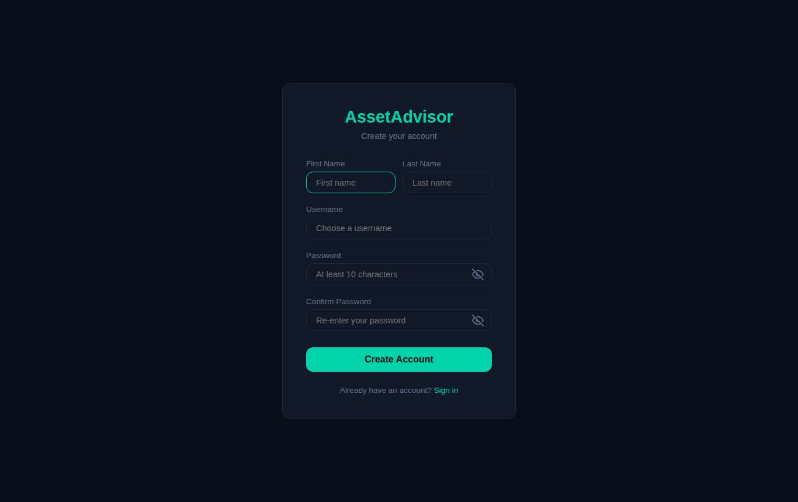

If you don't have an account yet, open the sign-in page and select **Create one** under the sign-in form. The **Create your account** form asks for:

| Field | What to enter |
|---|---|
| **First Name** and **Last Name** | Your name. Both are required. Your name appears in the top bar and in firm member lists. |
| **Username** | The name you sign in with. At least 3 characters, using only letters, numbers, hyphens and underscores. If someone already has it, you will see "Username already taken". |
| **Password** | At least 10 characters. Select the eye icon to show or hide what you typed. |
| **Confirm Password** | The same password again. |

Select **Create Account**. You are signed in straight away and taken to the setup wizard. If you started from a firm invitation link, you go back to the invitation instead so you can accept it.

Already have an account? Select **Sign in** at the bottom of the form.

### Signing in

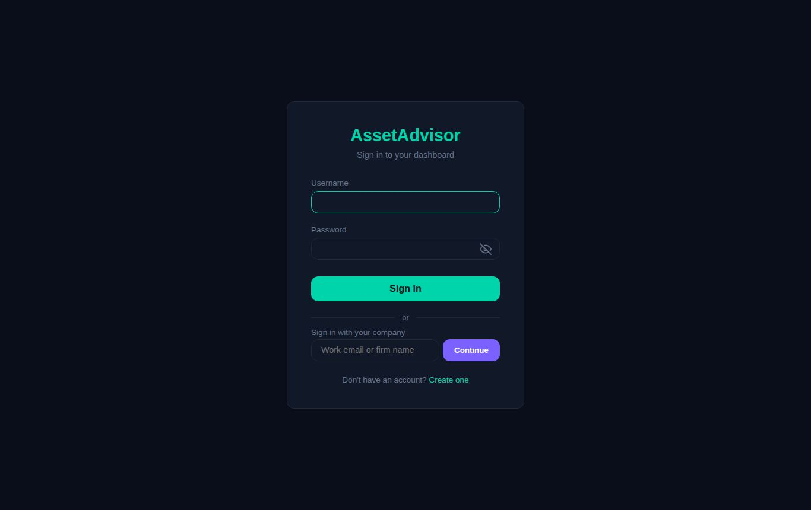

The sign-in page offers up to three ways in.

**Username and password.** Enter your **Username** and **Password** and select **Sign In**.

**Continue with Google or Continue with Microsoft.** These buttons appear only when the site has them turned on.
- **Continue with Google** works for accounts that have connected Google under **Settings**, **Connected sign-ins**. If your firm has listed its company email domains, a Google account with a verified email address on one of those domains gets an AssetAdvisor account automatically the first time it signs in, and joins the firm.
- **Continue with Microsoft** works only for accounts that have already connected Microsoft under **Settings**. It does not create new accounts.

**Sign in with your company.** If your firm has set up company sign-in, type your **Work email or firm name** and select **Continue**. You are sent to your company's sign-in page and then back to AssetAdvisor. If this is your first time, an account is created for you and you join the firm. Typing your work email is the easiest choice; it works when your firm has listed its email domains. The firm name here means the firm's short web name, written in lowercase with hyphens in place of spaces (for example `harbor-capital-partners`), so ask your firm admin if it doesn't find your firm.

If a sign-in goes wrong, the reason is shown in red at the top of the form.

**Good to know**

- After 5 wrong passwords, sign-in for that username is paused for 5 minutes. You will see "Too many failed attempts. Try again in 5 minutes."
- If your firm requires company sign-in, signing in with a password is refused and the message tells you to use **Sign in with your company** instead. Firm admins can still use their password, so a firm can never lock itself out.
- You stay signed in for 24 hours. If you belong to a firm that sets a shorter session length, the shortest one applies.
- To end your session, open the user menu and select **Logout**. Always do this on shared computers.

### Joining a firm by invitation

Firm admins invite people by sending them a link. When you open the link you see **You're invited to join** followed by the firm's name, the role you will have, and the date the link expires.

- If you are already signed in, select **Join** followed by the firm's name. You are taken to the firm's page.
- If you are not signed in, select **Sign in to accept** (if you already have an account) or **Create an account**. After you sign in or register you come back to the invitation and can join.

Each link works once and expires after 7 days. If it has been used, revoked or has expired, the page says so; ask your firm admin for a new one.

The roles you might be invited with:

| Role | What it lets you do |
|---|---|
| Admin | Manage members, sign-in and all portfolios |
| Portfolio manager | Create and manage portfolios, log trades |
| Analyst | View all firm portfolios |
| Compliance | View portfolios, the audit trail and access reviews |
| Viewer | View all firm portfolios |

See **Firm accounts** for more about firms.

### The setup wizard

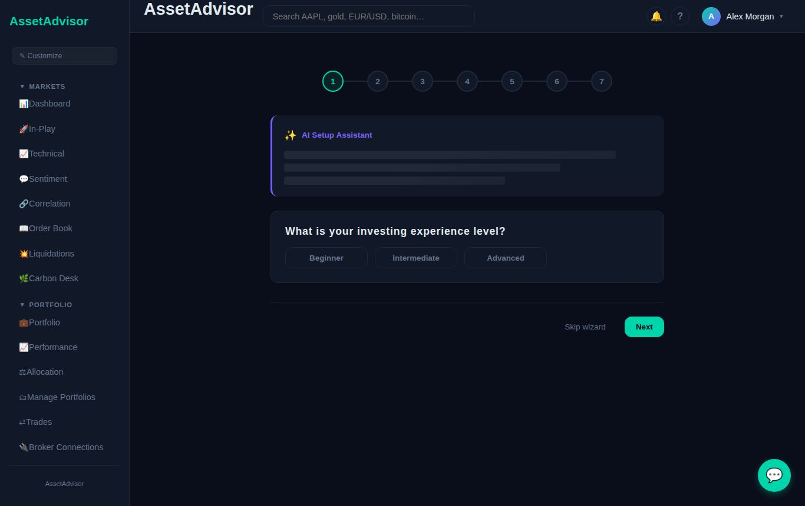

New accounts start in the setup wizard. It is a short, friendly introduction with tips from the **AI Setup Assistant** panel, which adapts its advice to your answers. You can come back to it at any time from the user menu: select **Setup Wizard**.

The numbered circles at the top show your progress through seven steps:

1. **Welcome.** Choose your experience level: **Beginner**, **Intermediate** or **Advanced**. You must pick one to continue.
2. **Interests.** Select every topic you care about: **Portfolio Tracking**, **DeFi / Yield**, **Trading**, **NFTs**, **Tax Planning**, **Market Analysis**, **Whale Watching**. Pick at least one to continue.
3. **API Keys.** Optional keys for outside services: Anthropic (Claude), OpenAI, CoinGecko and Etherscan. Select a service to open it, paste the key, or use **Get your key** to visit the provider. Keys you enter here are saved to your **API Keys** page when you leave the step. You can add more later on that page.
4. **Wallet.** Select **Connect MetaMask** to fill in your MetaMask address, or type a wallet address to watch. Watching is read-only: no private keys are needed. When you select **Next**, the address is added to your **Crypto Wallets** page with the label "Wallet", and you see **Wallet added**. Ethereum-style addresses (starting with 0x), Bitcoin and Solana addresses are accepted; any other text shows an error and keeps you on the step. You can change the chain or label later on the Crypto Wallets page. Leave the box empty to add nothing.
5. **Alerts.** Select **Go to Alerts Page** to set price alerts now, or **Set up later**. A link lets you **set up WhatsApp** to get alerts on your phone.
6. **Portfolio.** Choose your risk tolerance: **Conservative**, **Moderate** (the default) or **Aggressive**. The assistant updates its advice for your choice.
7. **Complete.** A summary of your answers. Select **Go to Dashboard** to finish and save your profile.

Use **Next** and **Back** to move between steps. The API Keys, Wallet, Alerts and Portfolio steps also have **Skip this step**. On the first step, **Skip wizard** takes you straight to the dashboard.

When you finish with **Go to Dashboard**, your experience level, interests and risk tolerance are saved to your investor profile. The AI assistant also remembers them, so its answers suit you; you can see, edit or delete these facts on the **AI Memory** page. If you leave with **Skip wizard**, nothing from these steps is saved. Running the wizard again and finishing replaces your earlier answers.

### The interactive tour

The first time you reach the dashboard, an interactive tour starts by itself. It dims the screen, highlights one part of the app at a time and explains it in a small box. It has 11 steps: a welcome, the sidebar, the user menu, your dashboard, quick actions, In-Play, Portfolio and Trades, price alerts, the AI Assistant pages, the chat button, and a closing summary. Some steps move you to the page they describe.

How to use it:

- **Next** and **Back** move through the steps. On the last step, **Get Started** closes the tour.
- The dots at the bottom jump straight to any step.
- **Skip tour** closes it at any time.
- **Ask a question** opens a small box where you can type a question about the step you are on. The AI assistant answers right inside the tour.
- On a keyboard, the right arrow or Enter goes forward, the left arrow goes back, and Esc closes the tour.

Once you finish or skip the tour, it does not start by itself again. To see it again, select the **?** button in the top bar, or **Interactive Guide** in the user menu.

### Finding your way around

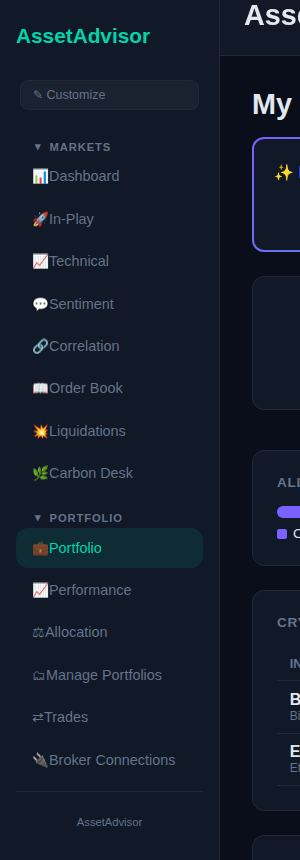

The screen has three parts: the sidebar on the left, the top bar across the top, and the page you are working on in the middle. The chat button for the AI assistant sits in the bottom-right corner.

#### The sidebar

Pages are grouped into four sections:

| Group | Pages |
|---|---|
| **Markets** | Dashboard, In-Play, Technical, Sentiment, Correlation, Order Book, Liquidations, Carbon Desk |
| **Portfolio** | Portfolio, Performance, Allocation, Manage Portfolios, Trades, Broker Connections, Import Trades (CSV), Backtest, Share, Crypto Wallets, On-chain P&L, Firm Accounts |
| **Tools** | Alerts, DCA Calculator, DCA Plans, Tax Report, Converter, Exchanges, Help & Docs |
| **AI Assistant** | Market Briefing, Risk Report, Tax Optimizer, Portfolio Builder, Pattern Recognition, Trading Coach, AI Memory, Search |

Select a group name to fold it up or open it again. The page you are on is highlighted.

**Customize the sidebar.** Select **Customize** at the top of the sidebar. While you are customizing:

- Select the pin icon next to any page to pin it. Pinned pages appear in a **Pinned** group at the very top of the sidebar. Select the pin again to unpin.
- Select the eye icon next to a group name to hide that whole group. Hidden groups stay visible (dimmed) while you customize, so you can select the eye again to bring them back.

Select **Done** when you are finished. Your folded groups, pins and hidden groups are saved to your account, so they follow you to any device.

On a phone or narrow window, the sidebar is tucked away. Select the menu button (three lines) to open it, and select the X or anywhere outside it to close it.

#### The top bar

From left to right:

- **Search box.** Type a ticker or name, such as AAPL, gold, EUR/USD or bitcoin. Matching stocks, ETFs, futures, currencies, bond yields and crypto appear in a list as you type. Select one, or use the arrow keys and Enter, to open that instrument's page.
- **Portfolio switcher.** This drop-down appears only when you can see more than one portfolio. It decides which portfolio the Portfolio, Trades, Performance and Risk pages show. It lists **All my portfolios** (when you have more than one), your own portfolios under **My portfolios**, each firm's portfolios under the firm's name (with an **All** option for the whole firm when it has more than one), and portfolios others shared with you under **Shared with me**, marked **(view only)** where you can only look.
- **Notification bell.** Opens the In-Play page, where your notifications and In-Play hits live. A red badge shows how many are new: unread notifications plus In-Play hits you haven't seen yet. It refreshes every minute.
- **? button.** Starts the interactive tour.
- **Your name.** Opens the user menu.

#### The user menu

Select your name in the top bar. The top of the menu shows your name and account type. The items are grouped as follows.

**Account**

| Item | What it opens |
|---|---|
| **Settings** | Your profile, password, connected sign-ins and account deletion |
| **Change Password** | A form to change your password |
| **API Keys** | Keys for outside services |
| **Active Sessions** | Every device signed in to your account, with a way to sign them out |

**Data**

| Item | What it opens |
|---|---|
| **WhatsApp** | Set up WhatsApp to chat with the assistant and receive alerts there |
| **CSV Import** | Import trades from a spreadsheet file |
| **Data Export** | Download a copy of your data |
| **AI Memory** | What the AI assistant remembers about you |

**Admin**

| Item | What it opens |
|---|---|
| **Audit Log** | Your own account activity |
| **Setup Wizard** | The setup wizard, to run through it again |
| **Interactive Guide** | The interactive tour |
| **Help & Docs** | The Quick Start, this User Guide and the FAQ, to read online or download |

**Logout** at the bottom signs you out on this device. Your session ends on the server too, so a copy of it stops working at once.

The pages behind these items are described in **Settings, security and your data**.

## The dashboard

The dashboard is the first page after you sign in. It is made of tiles: Markets tiles with live prices, crypto market statistics, your watchlist, top coins, the Fear & Greed index, market dominance, 24-hour volume, your active alerts, recent activity and quick actions. You decide which tiles appear, in what order and how wide they are.

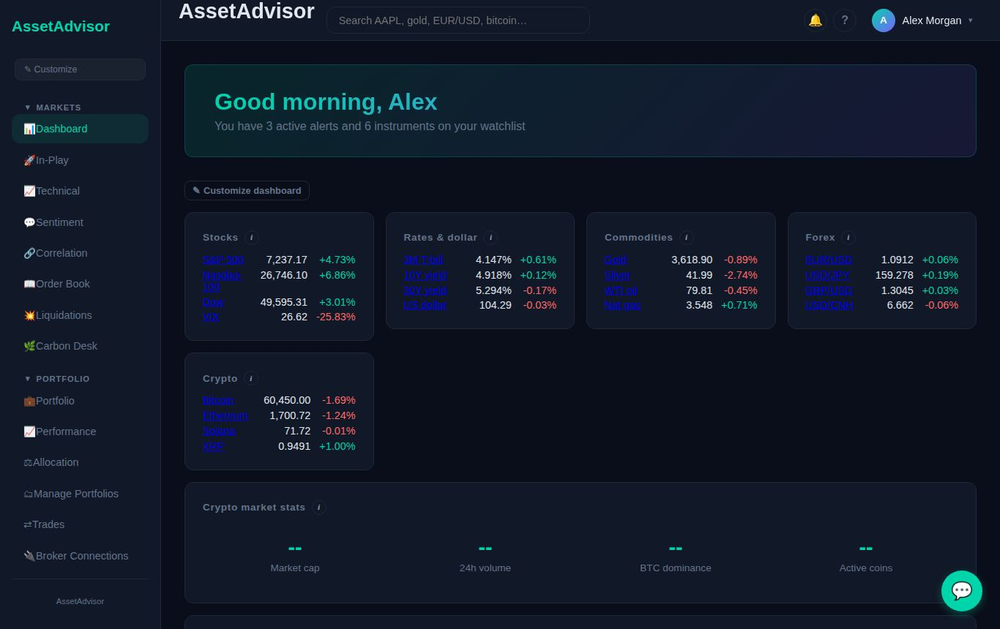

### What each tile shows

| Tile | What it shows |
|---|---|
| Markets tiles (Stocks, Rates & dollar, Commodities, Forex, Crypto, and any you create) | Each instrument's latest price and change. Select a name to open its chart. Stocks, rates and futures are delayed about 15 minutes; crypto is live. Prices refresh every minute |
| Crypto market stats | Total crypto market capitalization, 24-hour volume, Bitcoin's share of the market and the number of coins tracked |
| Your watchlist | Instruments you starred, with price and change. Select a card to open its chart |
| Top coins | The most-traded well-known cryptocurrencies right now, by 24-hour volume. Select the star to add one to your watchlist |
| Fear & Greed index | A 0 to 100 gauge of crypto market sentiment: 0 to 25 extreme fear, 26 to 45 fear, 46 to 55 neutral, 56 to 75 greed, 76 to 100 extreme greed |
| Market dominance | Each large coin's share of the total crypto market capitalization |
| 24h volume by coin | Dollar trading volume over the last 24 hours for the top coins |
| Active alerts | Alerts that have not fired yet, with what they watch and their time scale |
| Recent activity | Your latest trades, fired alerts and notifications |
| Quick actions | Shortcuts to set an alert, log a trade, convert currencies, read the AI briefing, open wallets and see In-Play |

Every tile has a small **i** button next to its name. Point at it (or focus it with the keyboard) to read what the tile shows. Screen readers announce the same description together with the tile's current numbers, and every chart and picture on the dashboard has a text description.

### Customizing the dashboard

Select **Customize dashboard** above the tiles. Each tile then shows its own controls:

- **Arrows** move the tile earlier or later. You can also drag a tile by its handle and drop it on another tile's place.
- **Width**: **Small**, **Medium**, **Large** or **Full width**. On a phone every tile is full width.
- **Hide** takes a tile off the dashboard. Hidden tiles stay visible (dimmed) while you customize, with a **Show** button to bring them back.
- In a Markets tile you can rename it, remove instruments with **×**, add any instrument with **Add an instrument** (search by ticker or name, up to 12 per tile) and remove the whole tile with **Delete this tile**.
- **+ Add Markets tile** creates a new tile, for example "Big tech" or "My ETFs", at the top of the dashboard.

Select **Save layout** to keep your changes, **Cancel** to throw them away, or **Reset to standard** to go back to the standard layout (your own Markets tiles are removed). Your layout is saved to your account, so it follows you to any device.

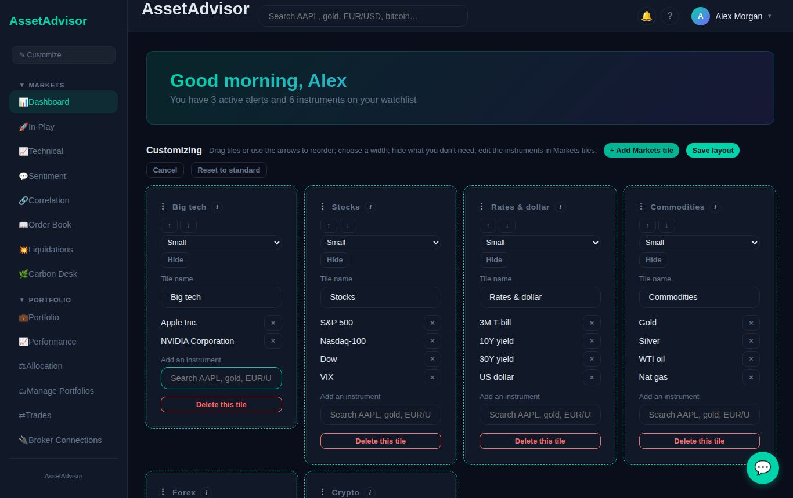

## Charts and indicators

Every instrument (stock, ETF, index, commodity, currency pair, Treasury yield, crypto) has its own page with a price chart. Open it from the search box, a Markets tile, your watchlist or anywhere an instrument name is a link. The same chart appears on the **Technical** page and on the older coin pages.

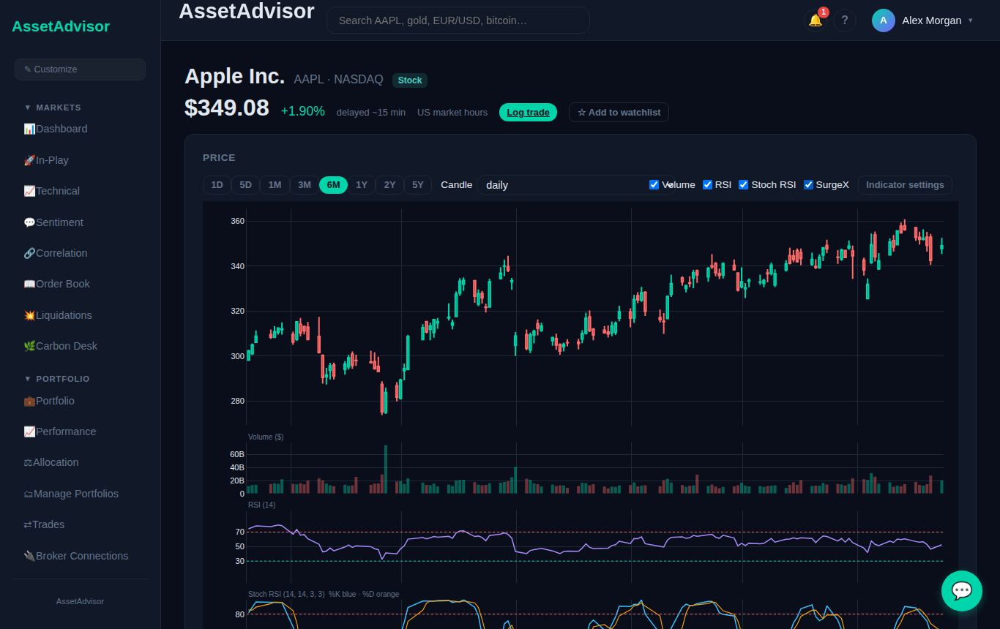

### Range and candle size

The chart has two separate controls:

- **Range** (**1D**, **5D**, **1M**, **3M**, **6M**, **1Y**, **2Y**, **5Y**): how much history the chart covers.
- **Candle**: how much time each candle stands for, from **5-minute** through 15-minute, 30-minute, 1-hour, 2-hour, 3-hour, 4-hour, 6-hour, 12-hour, **daily**, 3-day and **weekly** to 9-day.

Choose them independently, for example a 5-day range with 30-minute candles, or a 1-year range with daily candles. Sizes that don't fit the range are greyed out in the list, with the reason: too many candles (more than 900), too few (under 10), or, for stocks, futures and forex, minute candles older than 60 days, which the data source doesn't keep. When you change the range and your candle size no longer fits, the chart picks a sensible one. Your choices are remembered on this device.

### The panes

Below the candles are four panes you can switch on or off with the checkboxes next to the controls:

| Pane | What it shows |
|---|---|
| Volume | Dollar volume traded in each candle, green when the candle closed up and red when it closed down. Not shown for instruments without volume, such as yields and indexes |
| RSI | The Relative Strength Index (14 candles by default, the standard Wilder calculation): momentum on a 0 to 100 scale. Dotted lines mark overbought (70) and oversold (30) |
| Stoch RSI | Stochastic RSI: where RSI sits within its own recent range, 0 to 100. The blue line is %K, the orange line is %D (a smoothed %K). Dotted lines mark 80 and 20 |
| SurgeX | The smoothed rate of change of price: distance, velocity, acceleration or surge (you choose which in the settings). Above zero means rising, below zero falling |

All the panes share one time axis. Drag across any pane to zoom in, and every pane zooms to the same candles; double-click to zoom back out. A vertical line follows your pointer through all panes, and hovering shows every value for that candle.

Under the chart a line sums up the latest values in words, for example "RSI 43.7 (neutral). Stoch RSI %K 55.4 / %D 47.1. SurgeX (Surge): Price is moving up, and speeding up."

### Indicator settings

Select **Indicator settings** to change:

- **RSI length**, **RSI overbought** and **RSI oversold** levels.
- **Stochastic length**, **%K smoothing**, **%D smoothing**, and the **Stoch RSI upper** and **lower** lines.
- SurgeX: which series to **Plot**, the **Price** used, the **Moving average** (WMA or ALMA) and its periods, **Use Heikin Ashi candles**, and **Show SurgeX peaks and troughs** with their spread and spike settings.

Select **Apply** to redraw the chart, or **Reset to defaults**. The settings are remembered on this device and apply to every chart.

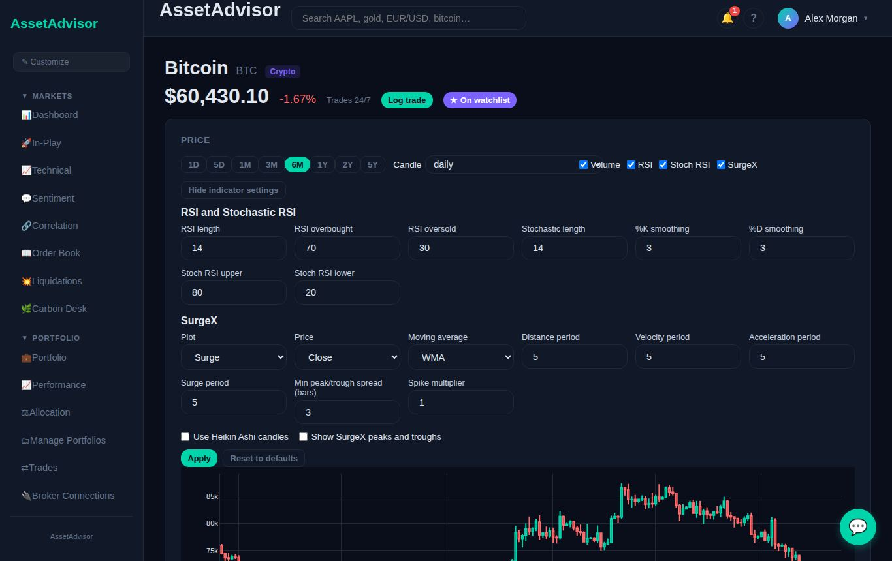

### The Technical page

**Technical** (in the Markets group) shows the same chart for the coin you pick at the top, with **AI Analysis** for a written reading of the indicators. Below the chart are extra indicator panels (RSI, MACD, Bollinger Bands). Select **Customize** to add, remove, rename, move or resize those panels.

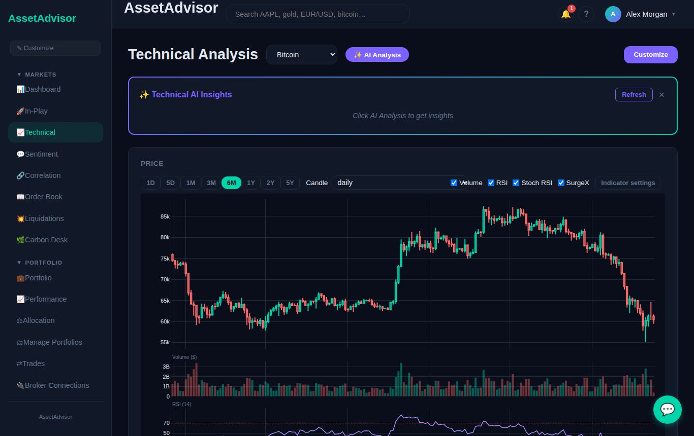

## Your portfolio

The pages in the **Portfolio** group of the sidebar are where you record what you own, see how it is doing, keep it on target, and get your trades in from brokers and files.

### The portfolio switcher

Everything on these pages belongs to one portfolio. The switcher in the top bar, next to the bell, sets which portfolio the pages show. It only appears when you can see more than one portfolio, so if you have just one portfolio and nothing is shared with you, you will not see it.

The list in the switcher has these parts:

- **All my portfolios**: a combined view of every portfolio you own. It appears when you own more than one. Portfolios that other people shared with you are not mixed in.
- **My portfolios**: each of your own portfolios. Client and model portfolios show their type in brackets, for example "(Client)" or "(Model)".
- A group for each firm you belong to, with each firm portfolio (and its client name, if it has one). When a firm has more than one portfolio, there is also an **All <firm name> portfolios** option for the whole firm combined.
- **Shared with me**: portfolios other people gave you access to, with the owner's name. View-only ones are marked "(view only)".

Your choice is remembered in this browser. If a remembered portfolio is later deleted or no longer shared with you, the switcher goes back to the combined view.

Combined views are for looking, not for actions that need a single portfolio. Setting allocation targets and downloading statements need one portfolio, so pick one first. Where a form can still work from a combined view (adding a trade, a cash movement or a broker connection), it asks you which portfolio to use.

### Portfolio

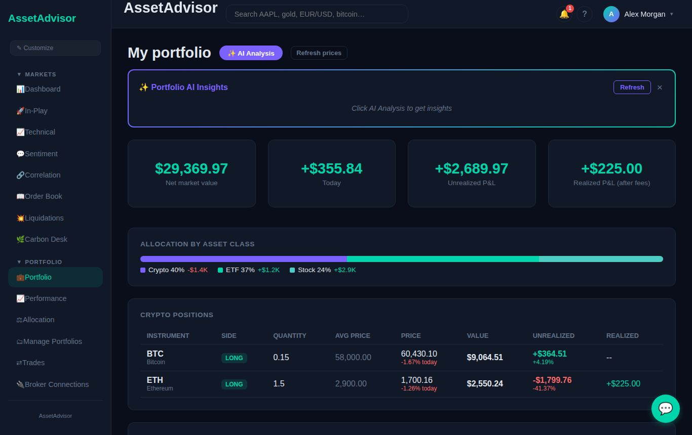

The **Portfolio** page shows what you hold right now and how much you have made or lost. Your holdings are built from the trades you record, so the page is empty until you log or import some.

**At the top**

- The page title is the name of the selected portfolio. A client portfolio also shows the client name. If someone else owns the portfolio, a badge shows whose it is and whether you **view only** or **can edit**.
- **AI Analysis** asks the AI assistant to review the portfolio. Its answer appears in a **Portfolio AI Insights** panel, which you can refresh or close.
- **Refresh prices** reloads the page with the latest prices.

**When you have no holdings yet**

A **Holdings** box explains that the portfolio is built from your trades. If you can edit the portfolio, it offers two shortcuts: **Add holding (log a trade)** and **Import trades from CSV**.

**Summary figures**

| Figure | What it means |
|---|---|
| **Net market value** | What your open positions are worth at current prices. Short positions count as negative. |
| **Today** | How much your open positions gained or lost today. For a position you opened today, this is its whole profit or loss so far. |
| **Unrealized P&L** | Profit or loss on positions you still hold: the difference between the current price and your average cost. It is "unrealized" because you have not sold yet. |
| **Realized P&L (after fees)** | Profit or loss you have locked in by closing all or part of a position, minus the fees you entered on your trades. |

**By portfolio** (combined views only)

When you look at several portfolios together, a table shows each one with its number of **Positions**, **Value**, **Today**, **Unrealized** and **Realized** amounts. Select a portfolio name to switch to it.

**Allocation by asset class**

A colored bar shows how your money is split between asset classes (crypto, stocks, ETFs, commodities, bonds, forex), with each class's share and its unrealized profit or loss. Shares are worked out from the size of each position, long or short. If you have short positions, a line underneath shows your long and short exposure separately.

**Positions tables**

There is one table per asset class, for example **Stock positions** or **Crypto positions**. The columns are:

- **Instrument**: the symbol and name. Select it to open that instrument's page.
- **Side**: **LONG** if you own it, **SHORT** if you sold it without owning it first.
- **Quantity**: how many shares, coins, contracts or units you hold.
- **Avg price**: your average cost per unit. In a combined view this can say "mixed" when you are long in one portfolio and short in another.
- **Price**: the latest price, with today's percentage change underneath. It says "unavailable" when there is no price right now.
- **Value**: quantity times price, in US dollars.
- **Unrealized**: open profit or loss in dollars and as a percentage of what you paid.
- **Realized**: profit or loss already locked in on this instrument.

**Closed positions**

Instruments you have fully sold (or fully covered) are listed here with their **Class**, the number of **Trades**, the date of the last trade (**Closed**) and the **Realized P&L**.

**How the numbers are worked out**

- Positions use the average-cost method. When you sell part of a position, the profit or loss is the sale price minus your average cost, times the quantity sold.
- A trade bigger than your open position closes it and opens a position on the other side with the remainder. For example, selling 15 shares when you own 10 leaves you short 5.
- Futures use their contract size. A 1.00 move in price is worth the contract multiplier per contract.
- Profit and loss on forex and other non-US-dollar instruments is converted to US dollars at today's exchange rate.

**Good to know**

- Stock, ETF and futures prices are delayed by about 15 minutes. Crypto prices are live.
- If some positions have no price right now, a note says how many, and they are left out of the value and unrealized totals until a price comes back.

### Performance

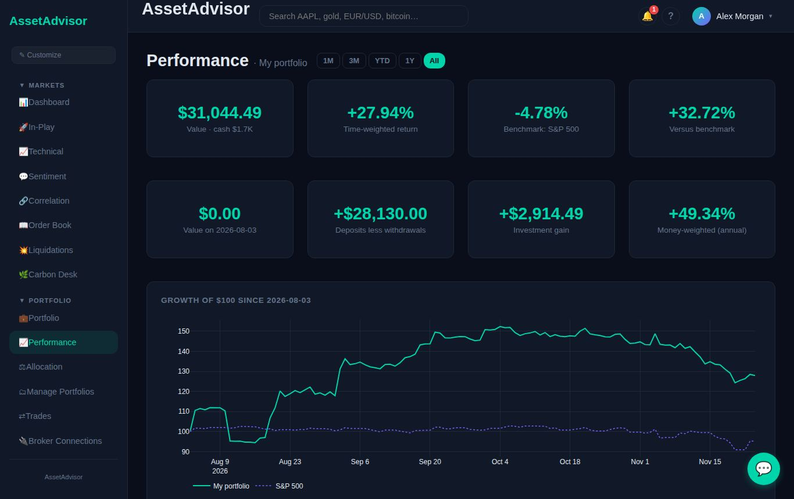

The **Performance** page shows how well your investments have done over time, compared with a benchmark. It also holds your cash movements and your PDF statements.

**Choosing a period**

The buttons next to the title pick the period: **1M** (the last 30 days), **3M** (the last 91 days), **YTD** (since the end of last year), **1Y** (the last 365 days) and **All** (since your first trade or cash movement). A period never starts before your first record.

If there is nothing yet, the page says "No trades or cash movements yet. Performance starts with the first one."

**Return figures, first row**

- **Value**: what the portfolio is worth today, with the cash part shown in the label. Value is cash plus your holdings at the latest daily close, plus the open profit or loss on futures.
- **Time-weighted return**: the return of your investment decisions over the period, with the effect of deposits and withdrawals removed. Each day's return is measured on its own and the days are chained together, so adding money is not counted as a gain. When the period is longer than a year, the label also shows the yearly rate ("/yr"). Use this figure to compare with a benchmark or another manager.
- **Benchmark**: the return of the portfolio's benchmark over the same period. The benchmark is chosen per portfolio on **Manage Portfolios** (the S&P 500 unless you change it). In a combined view, the benchmark of your default portfolio is used.
- **Versus benchmark**: your time-weighted return minus the benchmark's return. A positive number means you beat it.

**Return figures, second row**

- **Value on** (start date): what the portfolio was worth at the start of the period.
- **Deposits less withdrawals**: the money you added minus the money you took out during the period.
- **Investment gain**: how much the investments themselves earned. It is today's value minus the starting value minus net deposits.
- **Money-weighted (annual)**: your personal yearly return, which does include the effect of when you added or took out money. Adding money just before a rise helps this number; adding it just before a fall hurts it. It is shown only for periods of 30 days or more.

**Growth of $100**

The chart shows how $100 invested at the start of the period would have grown, using your time-weighted return (solid line) next to the benchmark (dotted line). Notes under the chart explain anything that affects accuracy, for example:

- "No deposits recorded, so purchases are treated as funded by deposits on the day they were made." Recording your real deposits and withdrawals gives exact returns.
- Positions in other currencies are converted to US dollars at today's exchange rate.
- Instruments with no daily price history are valued at their last trade price.
- For histories longer than 1,000 days, some older prices may fall back to trade prices.

**Monthly returns**

A table lists each month (newest first, up to 36 months) with your return, the benchmark's return and the **Difference**. This table always covers your whole history, whatever period button you picked.

#### Cash movements

Record money moving in and out of the portfolio so that returns measure your investments, not your deposits. If you can edit the portfolio, fill in:

- **Portfolio** (combined views only): which portfolio the entry belongs to.
- **Type**: one of the options below.
- **Amount ($)**, **Date** and an optional **Note**.

Then select **Add**.

| Type | Effect on returns |
|---|---|
| **Deposit** / **Withdrawal** | Money you add or take out. Not counted as performance, so adding money is not a gain. |
| **Dividend** / **Interest** | Income. Counts toward performance. |
| **Fee / charge** | A cost. Counts against performance. |

The table below the form lists every entry with its **Date**, **Type**, **Amount** (money out shows as negative) and **Note**. Select **Delete** to remove an entry. Trades move cash automatically, so you do not need to enter cash for buys and sells. Broker connections import cash movements for you.

#### Statements

Statements are PDF reports with returns against the benchmark, holdings, allocation and every transaction in a period.

- **Any period**: choose **From** and **To** dates (up to 10 years apart) and select **Download statement**. The dates start out as the beginning of the month two months ago through today.
- **Monthly statements**: a statement for each month is created automatically after the month ends, for every portfolio that had activity by then. You get a notification when they are ready. They appear as buttons after **Monthly:**, one per month. Select a month to download it.
- People you share a portfolio with can download its statements too.

Statements need a single portfolio. In a combined view, the box says "Pick one portfolio in the switcher to download its statements."

### Allocation

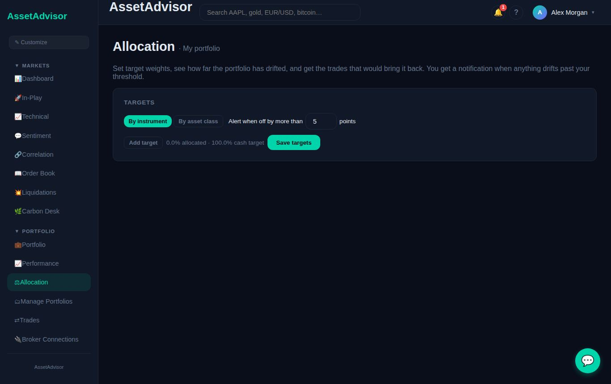

The **Allocation** page lets you set target weights for a portfolio, see how far it has drifted from them, and get a list of trades that would bring it back. Targets belong to one portfolio, so in a combined view the page asks you to pick one in the switcher.

**Setting targets**

The **Targets** box (shown if you can edit the portfolio) works like this:

1. Choose a style: **By instrument** (for example 30% Apple, 20% Bitcoin) or **By asset class** (for example 60% stocks, 20% crypto). A portfolio uses one style. Switching style clears the rows you have entered.
2. Select **Add target**, then pick an instrument or an asset class and type its weight in percent. Use **Remove** to drop a row.
3. Set **Alert when off by more than** ... **points**. This is your drift threshold, from 0.5 to 50 points. It starts at 5.
4. Select **Save targets**.

A running total shows how much is allocated and how much is left as your cash target, for example "80.0% allocated · 20.0% cash target". Whatever your targets do not cover is the cash target. You cannot save when the total is over 100%.

**Current vs target**

Once targets are saved, this table shows the portfolio's total value in its title and one row per target, plus any holding you did not set a target for (marked "(no target)") and a **Cash** row.

- **Target**: the weight you set.
- **Current**: the actual weight today, as a share of the portfolio's total value including cash.
- **Drift**: current minus target, in percentage points. A warning sign appears when drift is beyond your threshold.
- **Value** and **Target value**: what the holding is worth now and what it would be worth exactly on target.

A line underneath says how many allocations are outside your threshold, or that everything is within it. Futures count at their full contract value, so a leveraged position shows up as a large weight.

If the portfolio has no value to allocate, the page asks you to record a deposit on **Performance** first, with a **Go to Performance** link.

**Trades to rebalance**

This table lists the buys and sells that would bring each holding back to target: **Instrument**, **Side**, **Quantity**, **Price** and **Value**.

- Stocks, ETFs and futures are rounded down to whole shares and contracts. Forex is rounded to steps of 1,000 units. Crypto keeps up to 6 decimals.
- Prices are the latest available (stocks and futures about 15 minutes delayed).
- With asset class targets, the change for a class is spread across what you already hold in that class, in proportion to each holding's size. If you hold nothing in a class yet, the row says "Nothing held in this class yet; pick instruments to buy."
- If an instrument has no live price, a note says no order was suggested for it.

To record trades you have placed with your broker, tick the ones you want and select **Log selected trades**. After you confirm, they are added to your trade journal at the market price at that moment. This does not place any orders with a broker.

**Drift alerts**

Once a day AssetAdvisor checks portfolios that have targets. If anything has drifted past the threshold, you get a notification naming the largest drift. You get at most one such notification per portfolio per day.

### Manage Portfolios

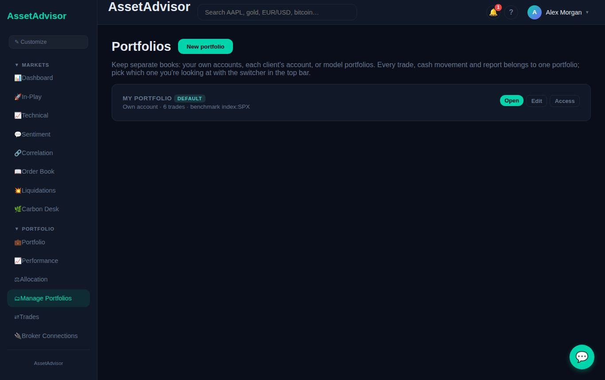

**Manage Portfolios** is where you create, edit, share and delete portfolios. Use separate portfolios to keep books apart: your own accounts, each client's account, or model portfolios. Every trade, cash movement and report belongs to one portfolio.

**At the top**

- **New portfolio** opens a form with:
  - **Name**
  - **Type**: **Own account**, **Client account** or **Model portfolio**
  - **Client name** (client accounts only)
  - **Benchmark**: search for any index or instrument (for example the S&P 500, BTC or AGG). Performance is compared with it. New portfolios start with the S&P 500.

  Select **Create**. The new portfolio becomes the one selected in the switcher.
- **View all combined** (when you own more than one portfolio) opens the **Portfolio** page for all your portfolios together.

**Your portfolio cards**

Each card shows the name, a **default** badge for your first portfolio, the type, client name, number of trades, benchmark, and how many people it is shared with. The buttons are:

- **Open**: selects this portfolio and opens the **Portfolio** page.
- **Edit**: change the name, type, client name or benchmark, then **Save**.
- **Access**: share the portfolio with other AssetAdvisor users. Type their username, choose a role and select **Give access**. Select **Remove** next to a person to take access away.

  | Role | What they can do |
  |---|---|
  | **Viewer** | Sees holdings, performance and statements. Cannot change anything. Suited to a client. |
  | **Manager** | Can also log trades and cash movements. Suited to a colleague. |

- **Delete** (not shown for your default portfolio, which can only be renamed): choose what happens to its trades and cash entries, either **Move to** another of your portfolios or **Delete them too**, then select **Delete** with the portfolio name. The portfolio is deleted straight away, with no extra confirmation. Its broker connections and sharing are removed as well.

**Shared with me**

Portfolios other people shared with you are listed separately, with who manages them, your access (view only or manager) and the number of trades. Select **Open** to view one, or **Remove from my list** to leave it.

### Trades

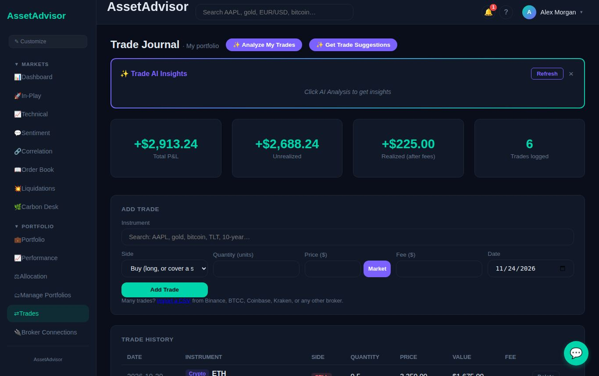

The **Trades** page (titled **Trade Journal**) is where you log trades by hand and see every trade in the selected portfolio.

**At the top**

- **Analyze My Trades** asks the AI assistant to review your trading. **Get Trade Suggestions** asks it for ideas. Answers appear in a **Trade AI Insights** panel.
- Four figures: **Total P&L** (unrealized plus realized), **Unrealized**, **Realized (after fees)** and **Trades logged**. These mean the same as on the **Portfolio** page.

**Add Trade**

If you have view-only access, you see "You have view-only access to this portfolio" instead of the form. Otherwise:

1. **Instrument**: search for a stock, ETF, crypto coin, futures contract or forex pair. If you came from an instrument's **Log trade** button, it is filled in already.
2. **Portfolio** (combined views only): which portfolio the trade goes into.
3. **Side**: **Buy (long, or cover a short)** or **Sell (close a long, or go short)**. You can sell something you do not own to open a short position.
4. **Quantity**: the label tells you the unit. It is shares for stocks and ETFs, contracts for futures, units of the first currency for forex (100,000 = 1 lot), and units for crypto.
5. **Price**: type it, or select **Market** to fill in the latest price. For forex, the price is in the second currency per unit of the first.
6. **Fee ($)**: optional. Fees reduce your realized profit.
7. **Date**: defaults to today.
8. Select **Add Trade**. A green message confirms what was logged.

Quantity and price must be above zero. For forex, a note explains that buying a pair means long the first currency, and that profit and loss is shown in US dollars at the current rate. For futures, a note shows how many dollars one contract gains or loses for each 1.0 move in price.

A link under the form points to **Import a CSV** for bulk imports.

**Trade History**

Every trade, newest first, with **Date**, **Portfolio** (combined views only), **Instrument** (select it to open the instrument page), **Side**, **Quantity**, **Price**, **Value** and **Fee**. Value is in US dollars, except for forex, where it is shown in the second currency. Select **Delete** to remove a trade. There is no confirmation step, so take care.

If some open positions have no live price, a note says their unrealized profit or loss is left out of the totals.

You can also ask the AI assistant to log trades for you.

### Broker Connections

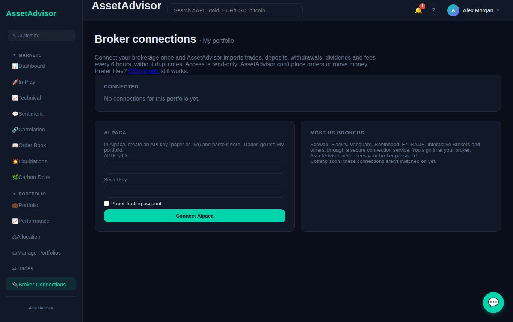

**Broker Connections** links a brokerage account so your trades, deposits, withdrawals, dividends and fees arrive automatically. Access is read-only: AssetAdvisor cannot place orders or move money. If you prefer files, you can still use the CSV import.

**Connected**

This table lists the connections for the selected portfolio:

- **Connection**: its name and provider (with "paper" for an Alpaca paper account).
- **Last sync**: when it last ran, or "not yet".
- **Result**: the outcome of the last sync. Problems show in red.
- **Sync now** fetches new activity immediately. **Disconnect** removes the connection (see below).

**Connecting a broker**

Each connection imports into one portfolio: the one selected in the switcher. In a combined view, choose it under **Import into portfolio** first.

- **Alpaca**: in your Alpaca account, create an API key (paper or live). Paste the **API key ID** and **Secret key**, tick **Paper-trading account** if it is a paper account, and select **Connect Alpaca**. AssetAdvisor checks the key with Alpaca before saving it.
- **Most US brokers** (Schwab, Fidelity, Vanguard, Robinhood, E*TRADE, Interactive Brokers and others): select **Connect with Plaid** or **Connect with SnapTrade** and sign in at your broker in the window that opens. AssetAdvisor never sees your broker password. With SnapTrade, finish in the SnapTrade window, then select **Sync now** on the new connection. If neither service is switched on for this site, the box says "Coming soon: these connections aren't switched on yet."

**How syncing works**

- The first sync brings in up to the last two years of activity.
- After that, connections sync every 6 hours, and whenever you select **Sync now**.
- Each broker transaction is imported only once, so syncing again never creates duplicates.
- Your keys and access tokens are stored encrypted.

**Disconnecting**

When you select **Disconnect**, you are asked whether to also delete what the connection imported:

- Choose **OK** to disconnect and delete the trades and cash movements it imported.
- Choose **Cancel** to keep them. You are then asked to confirm disconnecting while keeping the records.

Either way, syncing stops and the stored credentials are removed. Where the provider supports it, AssetAdvisor also asks the provider to revoke its access.

If you have view-only access to the portfolio, you can see its connections but not add, sync or remove them.

### Import Trades (CSV)

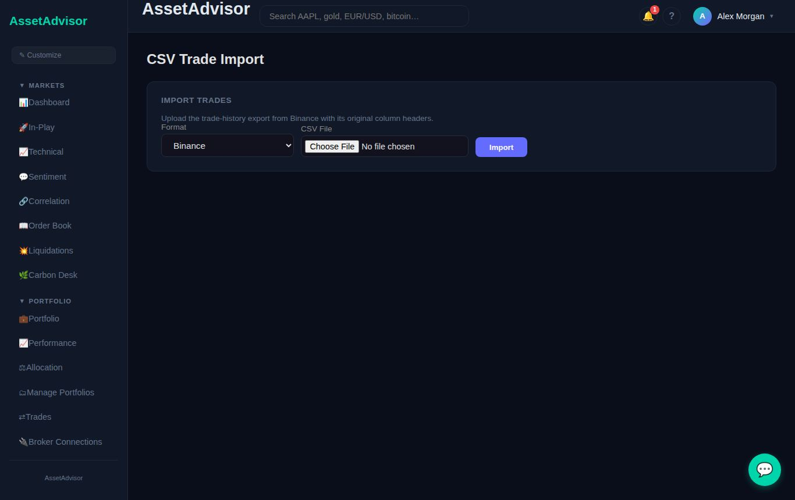

**Import Trades (CSV)** (titled **CSV Trade Import**) loads many trades at once from a file your exchange or broker gives you. Trades go into the portfolio selected in the switcher. In a combined view, they go into your default portfolio.

**Step 1: choose a format and a file**

Pick a **Format**, then choose your **CSV File** (CSV, TXT or TSV, up to 5 MB).

| Format | What to upload | What happens next |
|---|---|---|
| **Binance**, **Coinbase**, **Kraken** | The trade history export from that exchange, with its original column headers | A preview of the first 5 rows appears. Select **Import**. |
| **Generic** | Your own file with one row per trade and the columns `date, symbol, side, quantity, price`, optionally `fee` and `asset_class` | A preview of the first 5 rows appears. Select **Import**. |
| **BTCC** | Your BTCC trade history (spot or futures), as exported | You match the columns and preview before importing (see below). |
| **Other exchange or broker** | Any trade history export, comma, semicolon or tab separated | You match the columns and preview before importing (see below). |

Notes on the **Generic** format:

- `asset_class` can be stock, etf, crypto, commodity or bond.
- Without an asset class, a symbol that means more than one thing (BTC is a coin and also an ETF) is read as a stock first, then an ETF, then crypto.
- Instead of `symbol` you can give `instrument`, for example `commodity:GC`.
- Side can be buy/sell or long/short.

After a Binance, Coinbase, Kraken or Generic import, you see how many **Trades Imported** and **Duplicates Skipped**, plus any **Errors** (rows that could not be read, or rows that were not a buy or sell).

**Step 2 (BTCC and other brokers): match the columns**

A **Match the columns** box shows how many rows were found and the first rows of your file. AssetAdvisor guesses which column is which from the headers. If you have imported this kind of file before, it reuses your earlier choices.

- Fields marked with **\*** are required: **Date / time**, **Symbol / contract**, **Side or direction**, **Quantity (filled)** and **Price (fill / average)**. The optional ones, **Open / close (futures)** and **Fee**, can be left as **None**.
- **Market**: **Crypto**, **Stocks**, **ETFs**, **Commodity futures**, **Forex**, or **Mixed: work it out per symbol**.
- **Quantity multiplier**: if your file counts lots or contracts, enter the size of one (for example 0.001 BTC).
- **Date order**: **Detect**, **Day first (16/11/2026)** or **Month first (11/16/2026)**.

Futures fills such as "Open Long" and "Close Short" are understood. Select **Preview trades** once every required column is chosen. Nothing is saved yet.

**Step 3: check the preview and import**

The preview shows how many rows were read as trades, with each trade's **Date**, **Instrument**, **Side**, **Quantity**, **Price**, **Notional** (quantity times price) and **Fee**, and the net change in each position. Rows that will be skipped are listed under a red line you can expand.

Check the sides, quantities and prices. If the notional values look 1,000 times too big or too small, adjust the quantity multiplier. Then select **Import** (the button shows the number of trades, for example **Import 42 trades**). Your column choices are saved for next time.

**Duplicates**

A trade with the same instrument, date, quantity and price as one already in that portfolio is skipped, so importing the same file twice does not double your trades.

### Backtest

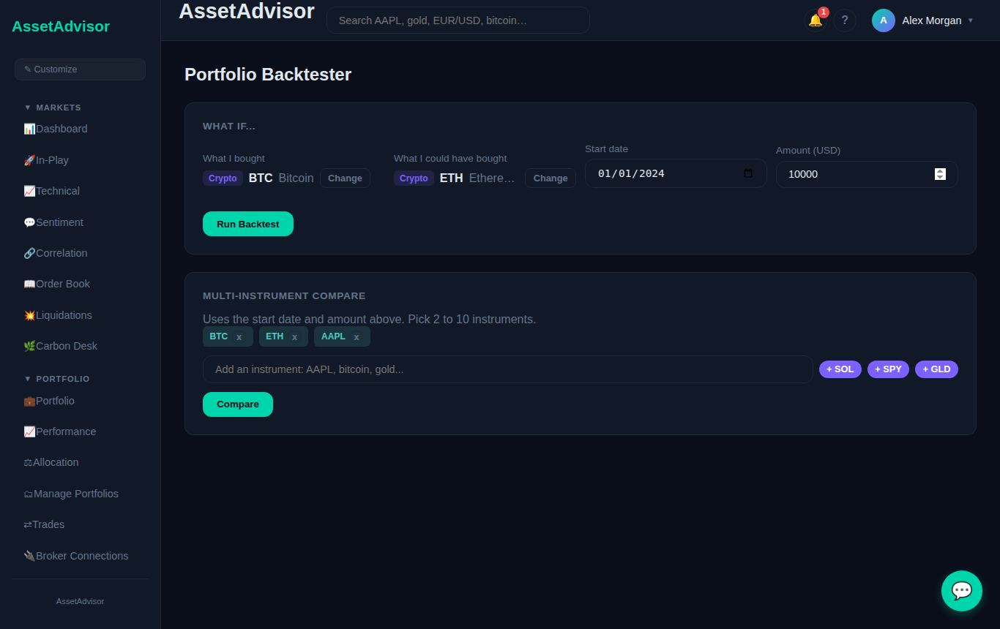

The **Backtest** page (titled **Portfolio Backtester**) answers "what if I had bought something else?". It works out what a sum invested on a past date would be worth today if you had bought and held. It works for crypto, stocks, ETFs and commodities priced in US dollars, and it is separate from your own portfolio.

**What If...**

1. **What I bought**: search for an instrument. It starts as Bitcoin.
2. **What I could have bought**: the instrument to compare it with. It starts as Ethereum.
3. **Start date**: any past date.
4. **Amount (USD)**: the sum invested, above zero.
5. Select **Run Backtest**.

The results show:

- **<symbol> value now** for each instrument, with its total return as a percentage.
- **<second symbol> vs <first symbol>**: how many dollars more (or less) the alternative would be worth today.
- A chart, **Value of $<amount> since <date>**, with one line per instrument.
- A table with one row per instrument. The better one is marked **Best**.

| Column | What it means |
|---|---|
| **Final value** | What the investment is worth at the latest daily close. |
| **Total return** | The gain or loss as a percentage of the amount invested. |
| **Annualized** | The average yearly return. Shown only when the test covers a year or more. Otherwise it shows "--". |
| **Max drawdown** | The biggest drop from a high point to a later low along the way, as a percentage. It shows how painful the worst stretch was. |
| **Volatility** | How much the value swung from day to day, expressed as a yearly percentage. Higher means a bumpier ride. |

**Multi-Instrument Compare**

This box uses the same **Start date** and **Amount (USD)** as above. It starts with BTC, ETH and AAPL.

- Add instruments with the search box, or with the quick buttons such as **+ SOL**, **+ SPY** or **+ GLD**. Remove one with its **x**. You can compare 2 to 10 instruments.
- Select **Compare**.

You get a card for each instrument, plus an **Equal-weight basket** card. Each instrument's card assumes the whole amount went into that instrument. The basket splits the amount evenly across all of them on the start date and is never rebalanced. A chart shows every instrument, with the basket as a dotted line, and the same statistics table as above.

**How it works and its limits**

- You buy at the opening price of the first trading day on or after the start date, then hold. The value is checked at each daily close.
- Fees, slippage, dividends and taxes are not included.
- When you compare several instruments, they all start on the same day: the first day for which every one of them has prices.
- Daily price history goes back about 1,000 days (about 2.7 years) for crypto and up to 10 years for other instruments. If your start date is earlier than the data, a note under the results says which date the backtest really started on.
- Only instruments priced in US dollars can be tested. If one is priced in another currency, you see a message saying so.

### Share

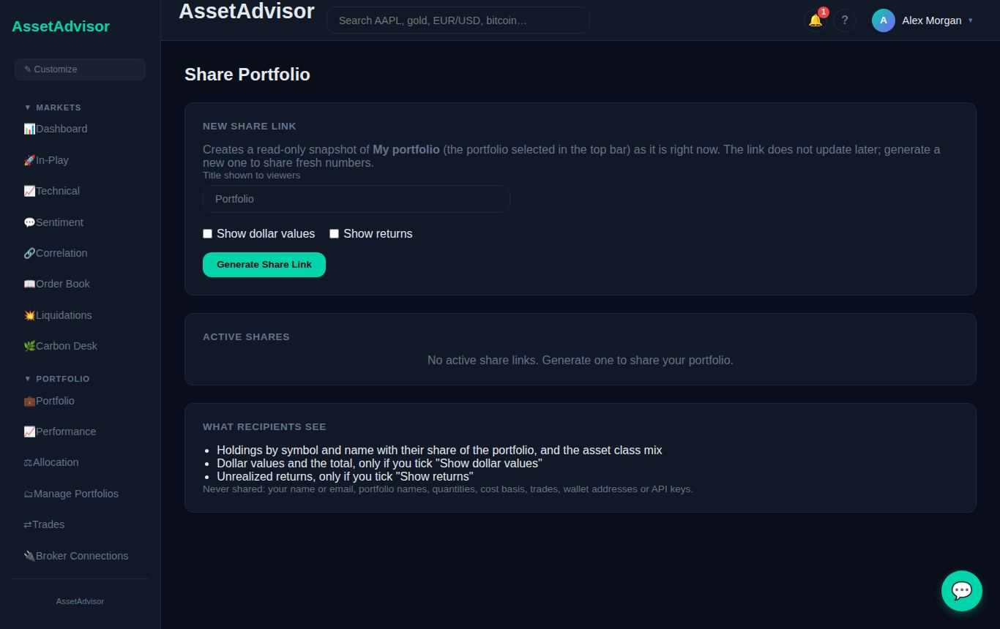

The **Share** page (titled **Share Portfolio**) creates public, read-only links to a snapshot of your portfolio. Anyone with a link can open it without signing in. To give a specific person ongoing access instead, use **Access** on **Manage Portfolios**.

**New Share Link**

The link is a snapshot of the portfolio selected in the top bar, frozen at the moment you create it. It does not update later. To share fresh numbers, create a new link. You can only share your own portfolios. If a portfolio someone shared with you is selected, the page asks you to switch to one of yours.

1. **Title shown to viewers**: an optional heading of up to 60 characters. If you leave it empty, viewers see "Portfolio".
2. Choose what to include:
   - **Show dollar values**: adds each holding's value and the total.
   - **Show returns**: adds each holding's unrealized return (open profit or loss as a percentage of cost) and the overall figure.
3. Select **Generate Share Link**.

The new link appears with a **Copy Link** button. You need at least one open position with a current price. Positions without a price are left out of the snapshot. You can have up to 20 active links. To make another after that, revoke one first.

**Active Shares**

Each link shows its title, its address, when it was created, how many holdings it contains and what it shows. Its buttons are:

- **Open**: view the link as a recipient would.
- **Copy Link**: copy the address to send to someone.
- **Revoke**: after you confirm, the link is deleted. Anyone who opens it afterward sees **Link unavailable**.

**What recipients see**

| Always shown | Only if you ticked the box | Never shown |
|---|---|---|
| Each holding's symbol, name, asset class and share of the portfolio (its weight), short positions marked **Short**, and the asset class mix | Dollar values and the **Total value** (**Show dollar values**). Each holding's return and the overall **Unrealized return** (**Show returns**) | Your name or email, portfolio names, quantities, cost basis, trades, wallet addresses or API keys |

The shared page states when the snapshot was taken, that it does not update, and that it is for information only and not investment advice.

### Crypto Wallets

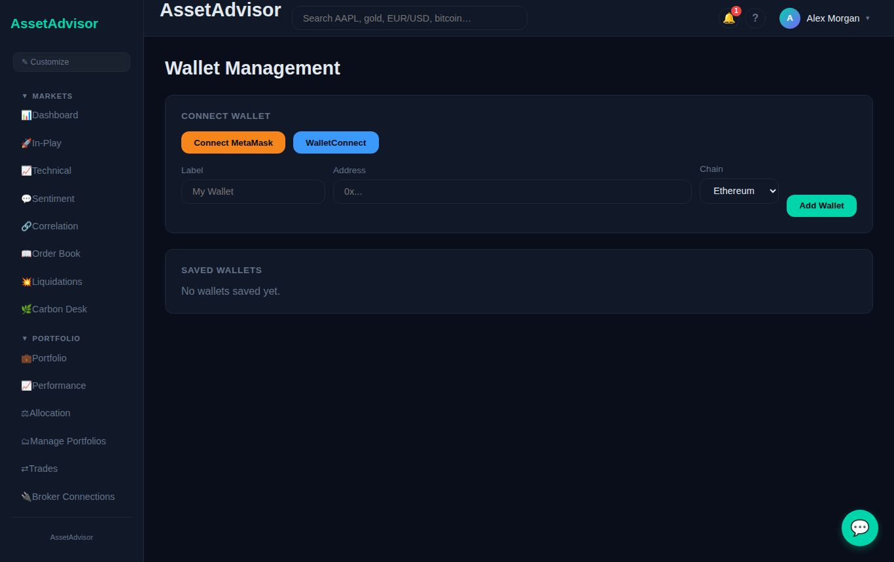

**Crypto Wallets** (titled **Wallet Management**) keeps a list of your crypto wallet addresses and shows what each holds. Saved wallets are separate from your portfolios: they do not add holdings to the **Portfolio** page, which is built only from trades.

**Connect Wallet**

- **Connect MetaMask** reads the address from the MetaMask browser extension and fills in the form. If MetaMask is not installed, you see "MetaMask not detected. Please install it."
- **WalletConnect** opens a WalletConnect window so you can connect a wallet, and fills in the form with its address and chain.
- Or type it yourself: a **Label**, the **Address** and the **Chain** (Ethereum, Polygon, BSC, Arbitrum, Optimism, Avalanche, Base, Solana or Bitcoin).

Select **Add Wallet** to save it. The address is checked against the chain you picked. For example, an Ethereum-style address must start with 0x. If it does not fit, you see "That does not look like a valid ... address". The same address on the same chain cannot be saved twice.

**Saved Wallets**

Lists each wallet's label, address and chain. Select **Remove** to delete one. It is removed straight away, with no confirmation.

**Balances**

For each saved wallet, a card shows:

- The main coin of its chain (for example ETH, BNB, POL, AVAX, BTC or SOL), with the amount and its value in US dollars.
- For Ethereum wallets, ERC-20 tokens as well, largest first. Up to 10 are listed, with a count of any more.
- A **Total** for the wallet, and the **Source** of the data.

The **Total** at the top adds up all your wallets. Select **Refresh** to fetch balances again.

Good to know:

- Balances come from free public sources: Blockscout for Ethereum and its tokens, public network endpoints for the other chains, Blockstream or mempool.space for Bitcoin, and the public Solana network.
- Tokens without a price show "price unavailable" and are not counted in the total. A note says how many.
- If a source cannot be reached, that wallet's card shows an error instead of a balance. The other wallets still load.

### On-chain P&L

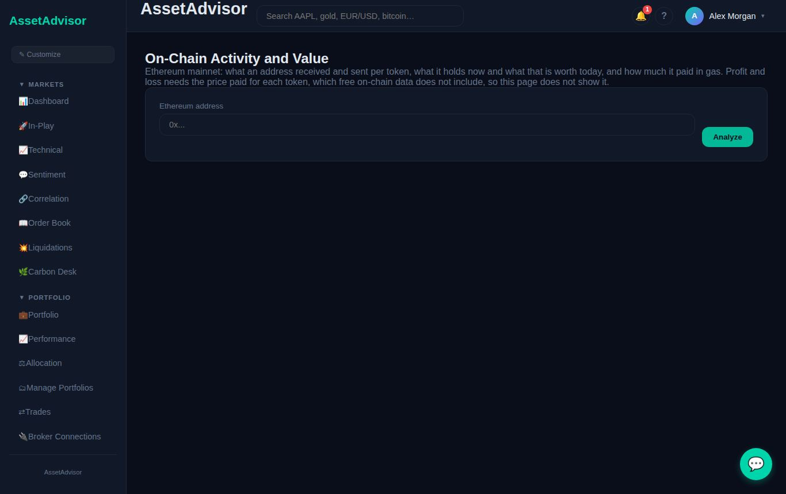

**On-chain P&L** (titled **On-Chain Activity and Value**) looks up an Ethereum address on the public blockchain. It shows what the address received and sent for each token, what it holds now and what that is worth today, and how much it paid in network fees ("gas"). It covers Ethereum mainnet only.

This page does not show profit and loss. That needs the price you paid for each token, and free blockchain data does not include it. For your real profit and loss, record your crypto trades on **Trades** or import them, and use the **Portfolio** page.

**Looking up an address**

1. If you have saved Ethereum-style wallets on **Crypto Wallets**, pick one from **Saved wallet**. Or type it into **Ethereum address** (0x followed by 40 characters).
2. Select **Analyze**. While it works, the button says **Reading the chain...**. Busy addresses can take a while.

**Results**

- **Value now**: what the address holds today, split into ETH and tokens. Tokens without a price are counted separately.
- **Gas spent**: total network fees paid, in ETH. Underneath, the same fees in US dollars at the ETH price on the day of each transaction, and at today's price, plus the number of transactions.
- **ETH net flow**: ETH received minus ETH sent, with both amounts and the current ETH balance.

The **Tokens** table lists each ERC-20 token with **Received**, **Sent**, **Net flow** (received minus sent), **Balance now**, **Price now** and **Value now**. A token with no price shows "no price".

**How these numbers are made**

This box lists the notes that apply to the address you looked up, for example:

- Values use today's prices. Tokens without a price are left out of totals.
- ETH flows count normal transactions only. ETH moved by smart contracts is not included.
- Only the latest 500 token transfers and 500 transactions are read. For an address with more history, flows and gas cover only the most recent activity.
- Tokens flagged as spam are hidden.

It also names the data source (Blockscout) and how many transactions and transfers were read. Results for an address are kept for 5 minutes, so looking it up again within that time shows the same numbers.

## Markets and tools

These pages help you spot unusual market moves, read the mood of the crypto market, study how coins move together, practice trading on a simulated carbon market, and run everyday calculations such as conversions, regular-purchase plans and realized gains.

### In-Play

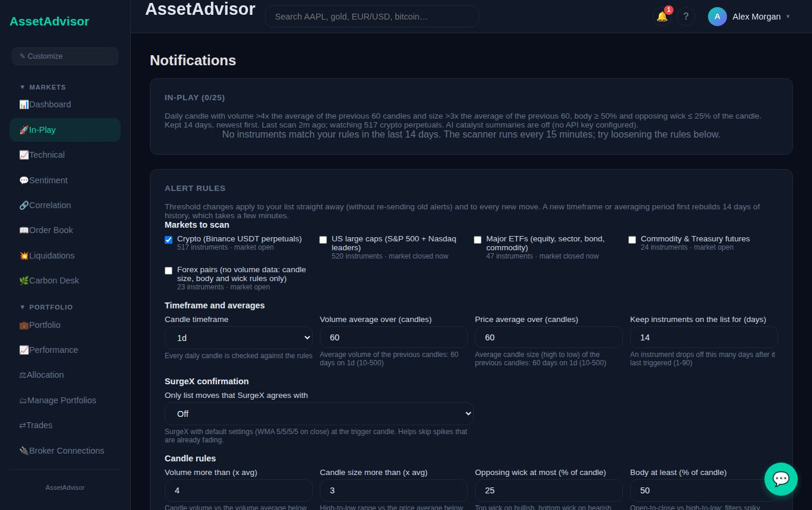

In-Play is a scanner that looks for instruments making a big, decisive move on unusually high trading volume, and then looks for the news that may explain it. The same page also holds your other notifications. The page heading reads **Notifications**.

#### The In-Play list

The **In-Play** card shows how many instruments are on the list and the maximum it can hold (for example **In-Play (7/25)**). Up to 25 are shown, newest first. Above the table, a short sentence restates your current rules in plain words, says when the last scan ran and how many instruments are being watched.

| Column | What it means |
|---|---|
| **Instrument** | The ticker and name, with a badge for its asset class. Select the ticker to open the instrument page. |
| **Move** | **▲ Bullish** (price rose) or **▼ Bearish** (price fell), and the percentage change over the candle. |
| **Volume** | The dollar volume traded in the candle, how many times the average that is (for example **5.2x avg**), and the average itself. Forex shows **n/a** because no volume data exists for currency pairs. |
| **Candle** | How many times bigger than average the candle's high-to-low range was, the **body** (how much of that range was a clean move from open to close), and the candle's date. **(live)** means the candle has not closed yet. |
| **Triggered** | How long ago the instrument first matched, and how many times it has matched if more than once. |
| **News catalyst** | The likely reason for the move. See below. |

The **News catalyst** column shows one of the following:

- A short summary marked **AI**, with the headlines it used under **Sources**.
- Up to three news headlines (more under a **more** link), when no AI summary is available.
- **No news catalyst found**, when nothing relevant was published around the time of the move.
- **Checking news…**, while the search is still running.

Headlines that only describe the price move itself (such as "XYZ jumps 20%") are not treated as a cause. They are tucked under **Price-move coverage** instead. If the line above the table says AI catalyst summaries are off, you will see headlines only.

On a phone, each instrument appears as a stacked card with the same information instead of a wide table.

The scanner runs every 15 minutes and the page refreshes itself every minute. Crypto prices come from Binance perpetual futures. Stocks, ETFs, futures and forex come from Yahoo Finance.

#### Alert Rules

The **Alert Rules** card controls what counts as an unusual move. Your changes apply only to your own list.

**Markets to scan.** Tick one or more:

- **Crypto (Binance USDT perpetuals)**
- **US large caps (S&P 500 + Nasdaq leaders)**
- **Major ETFs (equity, sector, bond, commodity)**
- **Commodity & Treasury futures**
- **Forex pairs** (no volume data, so only the candle size, body and wick rules apply)

Each option shows how many instruments it covers and whether that market is open right now. Crypto is selected by default.

**Timeframe and averages.**

- **Candle timeframe**: the candle length that is checked, from **1h** to **9d** (1h, 2h, 3h, 6h, 12h, 1d, 3d, 9d). The default is **1d** (daily).
- **Volume average over (candles)** and **Price average over (candles)**: how many earlier candles make up the "normal" level a new candle is compared with. The default is 60. The hint under each box translates the number into time (for example "2.5 days").
- **Keep instruments on the list for (days)**: how long an instrument stays listed after it last matched, from 1 to 90 days. The default is 14.

**SurgeX confirmation.** Under **Only list moves that SurgeX agrees with**, choose **Off**, **Velocity points the same way as the move**, or **Velocity and acceleration both agree (move still building)**. The stricter settings help skip spikes that are already fading.

**Candle rules.**

| Rule | Default | What it means |
|---|---|---|
| **Volume more than (x avg)** | 4 | The candle's volume must be this many times the average. The lowest allowed is 2. |
| **Candle size more than (x avg)** | 3 | The candle's high-to-low range must be this many times the average range. The lowest allowed is 2. |
| **Opposing wick at most (% of candle)** | 25 | Limits the wick against the move (the top wick on a rise, the bottom wick on a fall). |
| **Body at least (% of candle)** | 50 | The open-to-close move must fill at least this share of the candle, which filters out spiky candles that went nowhere. |

Select **Save rules** to apply your changes, or **Reset to defaults** to go back to the standard settings.

Changing a threshold updates your list straight away, without re-sending old alerts. Changing the timeframe or an averaging period first rebuilds the candle history, which takes a few minutes. While that happens a message says so, and the page checks back every 15 seconds.

For stocks and ETFs on hourly timeframes, volume is compared with the same hour of earlier trading sessions, because these markets trade only about 6.5 hours a day.

#### Phone Alerts

The **Phone Alerts** card sends each new In-Play hit to your phone through the free ntfy app.

1. Install **ntfy** from the iOS App Store or Google Play.
2. In the app, tap **+** and subscribe to the topic shown in the box (server: ntfy.sh).
3. Select **Turn on**, then **Send test** to check it arrives.

You can edit the topic and select **Save topic**. Select **Turn off** to stop alerts. Anyone who knows your topic name can read its messages, so keep it random.

#### Other Notifications

The **Other Notifications** card lists everything else, such as price alerts from the Alerts page. Read items appear faded. Select **Mark all read** to clear them.

### Sentiment

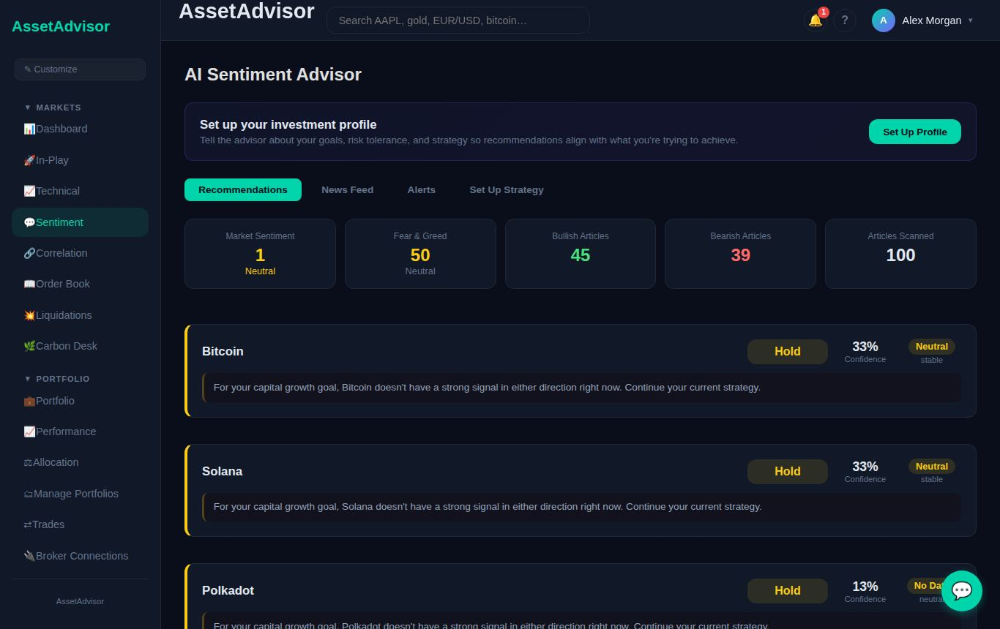

Sentiment reads crypto news and social posts, scores how positive or negative they are, and turns that into Buy, Hold or Sell suggestions shaped by your own investment profile. The page heading reads **AI Sentiment Advisor**.

#### Where the data comes from

Every 15 minutes the scanner collects articles from CoinDesk, CoinTelegraph, Bitcoin Magazine, CryptoSlate, The Block and Decrypt, posts from several crypto communities on Reddit, and headlines from CryptoPanic. The page refreshes itself every 5 minutes. Sentiment covers crypto only.

#### Your investment profile

If you have not set up a profile, a banner invites you to **Set Up Profile**. Once saved, the banner shows your strategy, risk level, goal, horizon and target return, with an **Edit Strategy** link. The **Set Up Strategy** tab (called **Your Strategy** after setup) has these sections:

- **Risk Tolerance**: **Conservative**, **Moderate**, **Aggressive** or **High Risk / Degen**.
- **Investment Strategy**: **Long-Term HODL**, **Swing Trading**, **Dollar-Cost Averaging**, **Active Trading** or **Yield / Income**.
- **Portfolio Goal**: **Capital Growth**, **Passive Income**, **Capital Preservation** or **Speculative Gains**.
- **Time Horizon**: from **Short-Term (< 3 months)** to **Very Long-Term (3+ years)**.
- **Target Annual Return**: a slider from 5% to 500%.
- **Monthly Investment Budget**: optional, in dollars.
- **Preferred Coins** and **Coins to Avoid**: comma-separated coin names in the form shown in the examples (such as bitcoin, ethereum, solana).
- **Investment Thesis / Notes**: anything else you want the advisor to consider.

Select **Save Strategy Profile** to save it. You return to the recommendations, recalculated for your profile. Each strategy weighs the signals differently: for example, Long-Term HODL pays less attention to daily news than Swing Trading does.

#### Market overview tiles

| Tile | What it means |
|---|---|
| **Market Sentiment** | The average tone of all recent articles, from -100 (very negative) to +100 (very positive), with a label from Very Bearish to Very Bullish. |
| **Fear & Greed** | The Crypto Fear and Greed Index (from alternative.me), 0 to 100. Up to 25 is Extreme Fear, above 75 is Extreme Greed. |
| **Bullish Articles** / **Bearish Articles** | How many recent articles leaned positive or negative. |
| **Articles Scanned** | How many articles the scores are based on. |

#### Recommendations

The **Recommendations** tab shows a card for Bitcoin, Ethereum, Solana, Cardano and Polkadot, plus any crypto on your watchlist and your preferred coins. Each card shows:

- The current price.
- The suggested action: **Strong Buy**, **Buy**, **Hold**, **Sell** or **Strong Sell**.
- **Confidence**: how strongly the individual signals agree with each other. It is lowered when fewer than three articles mention the coin.
- The coin's sentiment label and whether it is rising, falling or stable.
- A short written rationale.

Select a card to see the **Signal Breakdown**: bars for Sentiment, Price Trend, Volatility, Fear Greed, Volume and Goal Alignment, each from -100% (bearish) to +100% (bullish). The **Details** list shows the **Composite Score** (the weighted total of the signals), the strategy and risk level used, the number of articles, the 24-hour price change and the Fear and Greed value. **View Charts** opens the coin's chart.

If the list is empty, the first news scan has not finished yet. That can take up to 15 minutes.

#### News Feed

The **News Feed** tab lists recent articles with their source, age, the coins they mention and a sentiment label. Use **All** or a coin button (Bitcoin, Ethereum, Solana, Cardano, Polkadot, Avalanche) to filter. Select a headline to read the full article on the publisher's site.

#### Alerts

The **Alerts** tab lists sudden changes of mood: when a coin's sentiment score moves by 25 points or more, you see a **Bullish Shift** or **Bearish Shift** with the old and new scores and how many articles were analyzed. The check runs every 5 minutes. Select **Mark read** to dim an alert. The number of unread alerts also appears next to the page heading.

Sentiment scores and suggestions are automated readings of headlines, not financial advice.

### Correlation

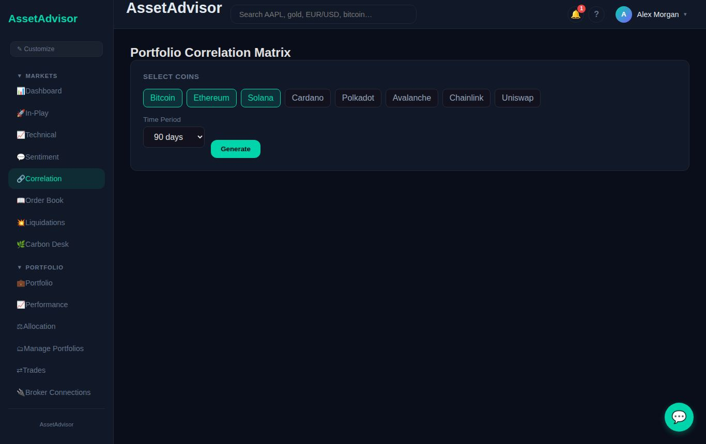

Correlation shows how closely selected coins move together. Coins that always rise and fall together offer little diversification. The page heading reads **Portfolio Correlation Matrix**, but it works on the coins you pick, not on your portfolio.

1. Under **Select Coins**, select at least two coins. You can choose from Bitcoin, Ethereum, Solana, Cardano, Polkadot, Avalanche, Chainlink and Uniswap.
2. Choose a **Time Period**: 30, 60, 90, 180 or 365 days.
3. Select **Generate**. A progress bar shows each coin being fetched.

**Correlation Matrix.** Each cell compares two coins' price changes, on a scale from -1 to +1:

| Value | Meaning |
|---|---|
| Close to +1 (dark green) | The two coins almost always move in the same direction. |
| Around 0 (gray) | Their moves are unrelated. |
| Close to -1 (dark red) | They tend to move in opposite directions. |

The diagonal is always 1.00, because each coin matches itself perfectly.

**Coin Statistics.**

- **Volatility**: how much the price typically swings from one price point to the next. Higher means a bumpier ride.
- **Mean Daily Return**: the average change from one price point to the next.

Prices come from CoinGecko. For periods of 90 days or less, CoinGecko supplies hourly prices, so the statistics for those periods describe hourly changes and look much smaller than for 180 or 365 days, which use daily prices.

### Order Book

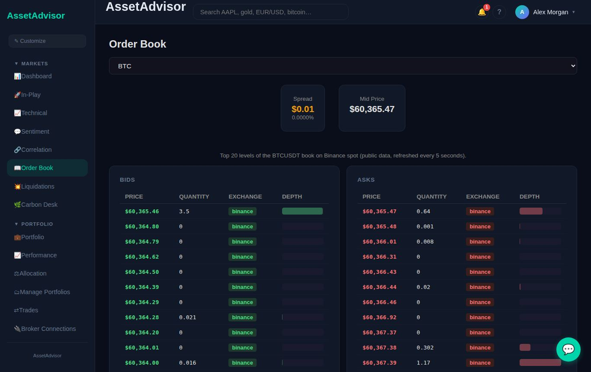

The Order Book shows the buy and sell orders currently waiting on Binance for a major cryptocurrency. Choose the coin from the list next to the heading: BTC, ETH, SOL, XRP, BNB, DOGE, ADA or LINK.

- **Spread**: the gap between the lowest asking price and the highest bid, in dollars, with the same gap as a percentage of the price underneath. A small spread means the market is easy to trade.
- **Mid Price**: halfway between the best bid and the best ask.

A line under the tiles names the trading pair (for example BTCUSDT) and confirms the source: the top 20 levels of that pair's book on Binance spot, public data, refreshed every 5 seconds.

The **Bids** table lists buyers, highest price first. The **Asks** table lists sellers, lowest price first. Each has up to 20 rows:

| Column | What it means |
|---|---|
| **Price** | The price of that level. |
| **Quantity** | How much of the coin is waiting at that price. |
| **Exchange** | Where the order sits (Binance). |
| **Depth** | A bar showing how large the level is compared with the biggest level on that side. |

The page shows one exchange's spot market only. It does not combine several exchanges or show futures markets.

### Liquidations

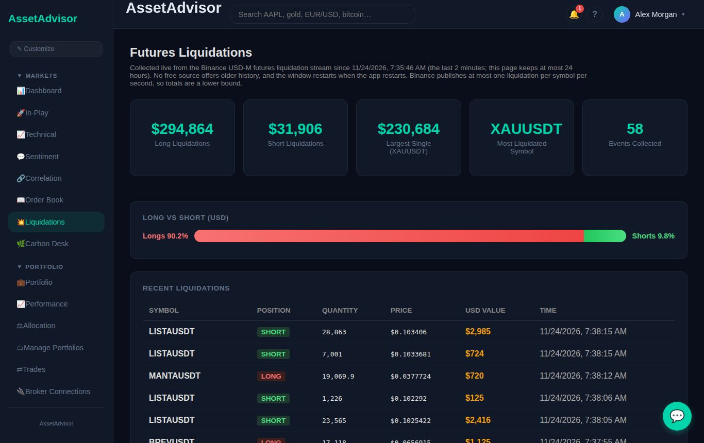

A liquidation happens when an exchange forcibly closes a leveraged futures position because the trader's margin ran out. Waves of liquidations often come with sharp price moves. The page heading reads **Futures Liquidations**.

#### Where the data comes from

AssetAdvisor listens to Binance's free, live futures liquidation feed and keeps what it collects. A line under the heading says when collection started and how much time it covers. Keep in mind:

- The page covers at most the last 24 hours. No free source offers older history.
- The window starts again whenever AssetAdvisor restarts, so after a restart it may cover only a few minutes.
- Binance publishes at most one liquidation per symbol per second, so the totals are a lower bound, not every liquidation.
- If the connection dropped, the line says how many times, and liquidations during those gaps are missing.

While the page is still connecting, the tiles show **--** instead of numbers.

#### What the page shows

| Tile | What it means |
|---|---|
| **Long Liquidations** | The dollar value of closed-out bets on rising prices. |
| **Short Liquidations** | The dollar value of closed-out bets on falling prices. |
| **Largest Single** | The biggest single liquidation, with its symbol. |
| **Most Liquidated Symbol** | The contract with the highest total dollar value liquidated. |
| **Events Collected** | How many liquidations are in the window. |

**Long vs Short (USD)** is a bar showing the share of longs against shorts by dollar value.

**Recent Liquidations** lists the latest events with **Symbol**, **Position** (**LONG** or **SHORT**, the position that was closed), **Quantity**, **Price**, **USD Value** and **Time**.

The page refreshes every 15 seconds.

### Carbon Desk

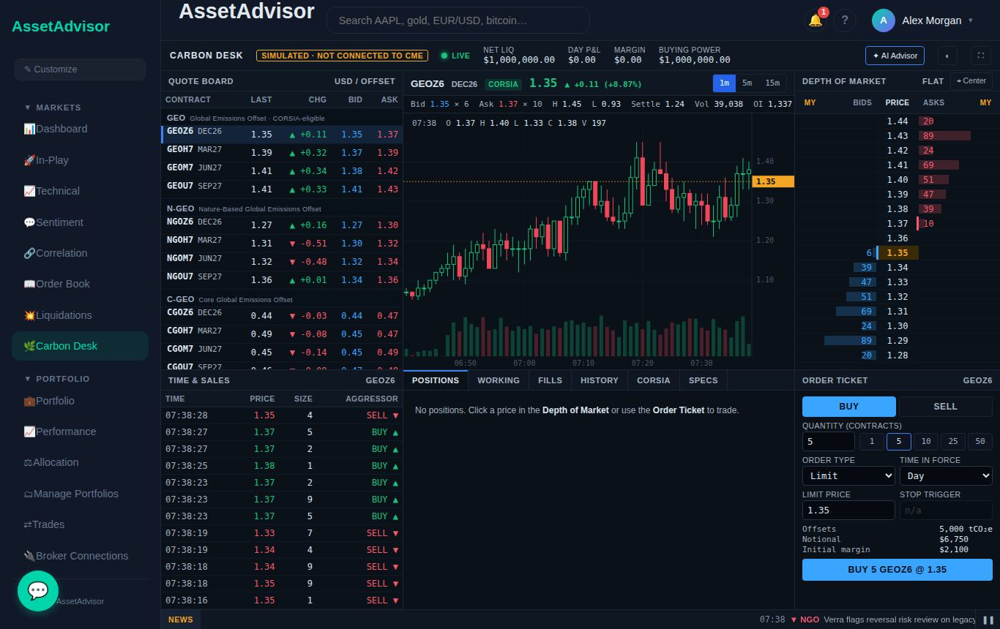

Carbon Desk is a practice trading screen for carbon offset futures, modeled on CME Group's emissions offset contracts. **Everything here is simulated**: the badge at the top reads **SIMULATED · NOT CONNECTED TO CME**, prices are generated by AssetAdvisor, and no real money or real orders are involved. Each user gets a practice account that starts with $1,000,000.

#### The contracts

| Product | What it represents |
|---|---|
| **GEO** | Global Emissions Offset. The only CORSIA-eligible contract (the airline offsetting scheme), backed by Verra, ACR and CAR units. |
| **N-GEO** | Nature-Based Global Emissions Offset (forestry and land-use offsets). |
| **C-GEO** | Core Global Emissions Offset (energy and technology offsets). |

One contract is 1,000 offsets, and one offset is one tonne of CO₂. Prices are quoted in US dollars per offset with a minimum step of $0.01, worth $10 per contract. Each product is listed for several delivery months. A simulated fee of $1.85 per contract is charged on each trade.

#### Top bar

The top bar shows the connection state (**LIVE**, or a stale warning while it reconnects), the Chicago time, and your account: **Net liq** (account value), **Day P&L**, **Unrealized**, **Margin** (money set aside for open positions) and **Buying power**. Three buttons sit on the right:

- **AI Advisor** opens the advisor drawer (see below).
- **Color-safe** swaps green and red for blue and orange, which is easier to tell apart with color-vision deficiency.
- **Full screen** fills the screen. Press Esc to leave.

#### Quote board and chart

The **Quote board** lists every contract with **Last**, **Chg**, **Bid**, **Ask** and **Vol**. Select a contract to trade it.

The chart above shows the selected contract's price, its change today and a stats line: **Bid** and **Ask** with their sizes, **H** and **L** (today's high and low), **Settle** (the reference settlement price), **Vol** (contracts traded) and **OI** (open interest, the number of contracts still open). Choose **1m**, **5m** or **15m** candles. Dashed lines mark your average price and any working orders.

#### Depth of market

The **Depth of market** ladder lists prices down the middle, with waiting buy quantities under **Bids** and sell quantities under **Asks**. Your own orders show in the **My** columns. The header shows your position (**LONG**, **SHORT** or **FLAT**).

- Select a number in the **Bids** column to load a buy limit order at that price into the order ticket. Select the **Asks** column for a sell limit.
- Select your own size in a **My** column to cancel your orders at that price.
- **⌖ Center** recenters the ladder on the current market.

With the ladder focused, you can also use the keyboard: up and down arrows move the cursor, B or Enter loads a buy, S loads a sell, C cancels your orders at that price, and Home returns to the market. Nothing is sent from the ladder; it only fills in the ticket.

#### Order ticket

1. Choose **BUY** or **SELL**.
2. Enter the **Quantity (contracts)**, from 1 to 500, or use the quick buttons (1, 5, 10, 25, 50).
3. Choose the **Order type**: **Limit** (at your price or better), **Market** (right away at the best available price), **Stop** (becomes a market order once the price reaches your trigger) or **Stop limit** (becomes a limit order at the trigger).
4. Choose **Time in force**: **Day** (expires at the end of the day), **GTC** (good till canceled), **IOC** (fill what you can now, cancel the rest) or **FOK** (fill all now or nothing). IOC and FOK are not available for stop orders.
5. Fill in the **Limit price** and/or **Stop trigger** as needed. Until you edit it, the limit price follows the best bid (for a buy) or best ask (for a sell). A buy stop must be above the last price, and a sell stop below it.

The summary shows the **Offsets** covered, the **Notional** value and the **Initial margin** needed. The submit button spells out the order, for example **BUY 5 GEOZ6 @ 1.18** (contract symbols combine the product, a month letter and the year digit). Orders of 100 contracts or more, or worth $250,000 or more, ask you to select a second time to confirm. A message under the button confirms the result or explains a rejection, such as a price too far from the market.

#### Time and sales

The **Time & sales** panel lists the latest trades in the selected contract: **Time**, **Price**, **Size** and **Aggressor** (whether the buyer or the seller started the trade).

#### Blotter tabs

| Tab | What it shows |
|---|---|
| **Positions** | **Net** contracts, **Offsets**, **Avg** price, **Mark** (current price), **Unrealized** and **Realized** profit or loss, and **Margin**. **Flatten** closes a position at market (select it twice to confirm). |
| **Working** | Orders that have not filled yet, each with **Cancel**. A button cancels all of them at once (select it twice to confirm). |
| **Fills** | Each execution with its price, **Liquidity** (whether your order added to or took from the book) and **Fee**. |
| **History** | All your past orders and their status. |
| **CORSIA** | A hedging helper (see below). |
| **Specs** | Contract specifications: unit, tick, tick value, initial margin, settlement and listed months. |

**CORSIA hedging.** Enter your **Annual CO₂ emissions (tonnes)** and select **Update**. The tab shows the **Offsets required** (your emissions times an illustrative CORSIA growth factor shown on the tab), how many are **Hedged · long GEO**, the **Coverage** percentage and the **Est. cost at offer**. Only long GEO positions count. Select **Load hedge ticket** to fill the order ticket with the buy needed. Nothing is sent until you submit the ticket yourself.

#### AI Advisor

The **AI trading advisor** drawer has two tabs:

- **Ideas**: **Suggested trades**, each with entry, stop, target, margin, risks and a confidence meter. Select **Load into ticket** or **Load stop** to fill the ticket, or **Ask about this** to discuss it. **Your positions** reviews each open position with advice. **How these ideas are made** explains the method.
- **Ask the advisor**: type a question about the market, your positions or your CORSIA hedge and select **Ask**. Answers usually take 20 to 40 seconds. **Start over** clears the conversation.

The advisor never places orders. You review and submit every one.

The **NEWS** strip along the bottom scrolls simulated market headlines. Use the pause button to stop it.

### Exchanges

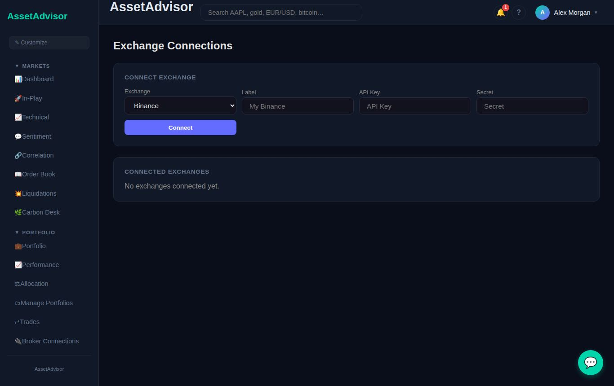

Exchanges lets you store API keys for a crypto exchange so AssetAdvisor can show your balances there. The page heading reads **Exchange Connections**. Only Binance and Coinbase are supported.

1. Under **Connect Exchange**, choose the **Exchange**: **Binance** or **Coinbase**.
2. Optionally give it a **Label**, such as "My Binance".
3. Paste your **API Key** and **Secret**. A key with read permission is enough. Keys are stored encrypted.
4. Select **Connect**.

**Connected Exchanges** lists your saved connections. Each one shows a status, checked by fetching its balances:

| Status | Meaning |
|---|---|
| **Connected** | The exchange accepted the key. |
| **Error** | The check failed. Hover over the badge for the reason, such as a rejected key or an unreachable exchange. |
| **Check failed** | The balance check could not be run at all. |

Select **Remove** to delete a connection. You are asked to confirm, and its stored key and secret are deleted.

**Exchange Balances** shows, for each connected exchange, every asset you hold there and the amount. Assets with a zero balance are left out.

This page only shows balances. It does not import trades or place orders. To have trades import automatically, use **Broker Connections** under Portfolio instead.

### Converter

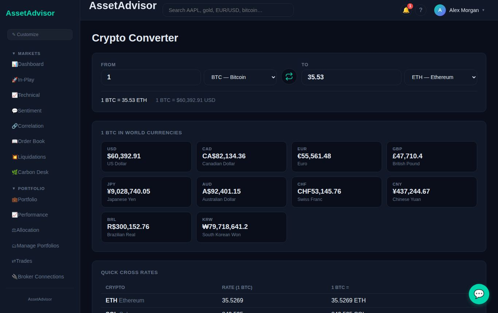

The converter works out what an amount of one cryptocurrency is worth in another, and in 16 traditional currencies. The page heading reads **Crypto Converter**.

1. Type an amount next to **From** and choose the coin.
2. Choose the coin to convert into next to **To**. The result appears straight away. Use the swap button between them to reverse the direction.

Below the boxes you see the rate (how many units of the To coin one unit of the From coin buys) and the price of one unit of the From coin in US dollars.

- **in World Currencies** shows your amount in USD, CAD, EUR, GBP, JPY, MXN, UAH, SEK, NOK, AUD, CHF, CNY, INR, BRL, KRW and TRY.
- **Quick Cross Rates** shows the rate and your amount converted into a dozen other coins.

There are 20 coins to choose from, including Bitcoin, Ethereum, Solana, XRP, Dogecoin and the stablecoins Tether and USD Coin. You can only convert from a cryptocurrency: traditional currencies appear as results, not as a starting point. Prices come from the live market feed (Binance), with currency exchange rates updated hourly, and are refreshed at most once a minute. The Quick Cross Rates table loads once when you open the page.

### Search

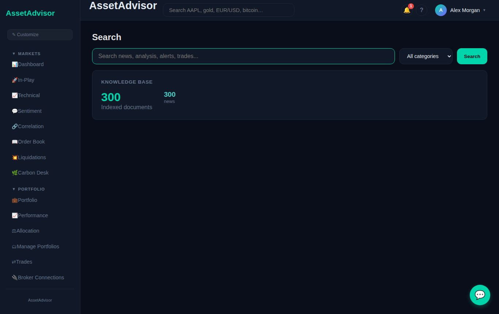

Search looks through AssetAdvisor's library of collected articles and your own assistant memory. It is different from the search box in the top bar, which opens an instrument's page.

1. Type at least two characters in the box (**Search news, analysis, alerts, trades...**).
2. Optionally narrow the results with the category list (**All categories**, **News**, **Analysis**, **Market Data**, **Alert**, **Conversation**, **Fundamentals**, **Trade**, **Research**).
3. Select **Search**.

Before you search, a **Knowledge Base** card shows how many documents are indexed, by category. Today the library is filled mainly by the crypto news that the Sentiment page collects.

Each result shows its category, title, age and source. Select a result to expand the full text. Facts the assistant has remembered about you that match your search appear under **From Your Memory**.

Select **Ask AI** above the results to get a written **AI Answer** to your query, drawing on the matching documents. Treat the answer as a starting point, not advice.

### DCA Calculator

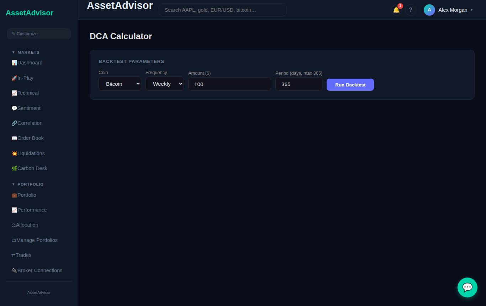

Dollar-cost averaging (DCA) means buying a fixed dollar amount at regular intervals, whatever the price. The calculator shows how that would have worked out over a past period, compared with investing the same total all at once.

1. Under **Backtest Parameters**, choose the **Coin**: Bitcoin, Ethereum, Solana, Cardano, Polkadot or Dogecoin.
2. Choose the **Frequency**: **Daily** (every day), **Weekly** (every 7 days) or **Monthly** (the same day each month).
3. Enter the **Amount ($)** of each purchase.
4. Enter the **Period (days, max 365)**, from 1 to 365 days back from today.
5. Select **Run Backtest**.

Purchases start on the first day of the period. Each one uses the first available price at or after its scheduled time.

The results show:

| Tile | What it means |
|---|---|
| **Total Invested** | The sum of all purchases. |
| **Current Value** | What the coins bought are worth at the latest price. |
| **ROI** | The plan's gain or loss as a percentage of what you put in. |
| **Lump Sum Value** | What the same total would be worth if it had all been invested on the first day. |
| **Lump Sum ROI** | The lump sum's gain or loss as a percentage. |
| **Buys** | How many purchases the plan made. |
| **Total Coins** | How many coins the plan accumulated. |

A sentence under the tiles sums up the plan, for example how many weekly buys were made and between which dates.

The **DCA vs Lump Sum** chart has one point per day and three lines: **DCA Value** (what your regular purchases are worth), **Lump Sum Value** and **Amount Invested (DCA)** (the money you had put in by that date). Where the DCA Value line sits above Amount Invested, the plan was in profit.

Prices come from CoinGecko, whose free history goes back at most one year. If CoinGecko is busy, you may see a message asking you to try again in a minute. This is a look back at history, not a forecast.

### DCA Plans

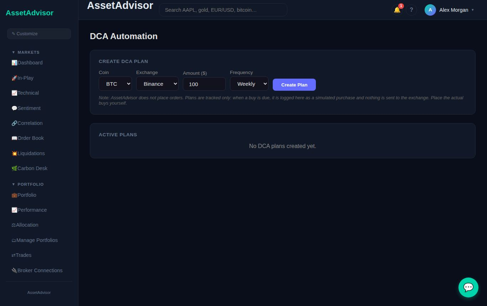

DCA Plans keeps track of a regular purchase schedule. The page heading reads **DCA Automation**.

**AssetAdvisor does not place orders.** When a purchase falls due, it is logged as a simulated buy and nothing is sent to the exchange. Place the actual purchases with your exchange yourself.

1. Under **Create DCA Plan**, choose the **Coin** (BTC, ETH, SOL, ADA, DOT, AVAX or LINK) and the **Exchange** you plan to use (Binance, Coinbase, Kraken, KuCoin or Bybit).
2. Enter the **Amount ($)** per purchase and choose the **Frequency** (**Daily**, **Weekly** or **Monthly**).
3. Select **Create Plan**.

**Active Plans** lists each plan:

| Column | What it means |
|---|---|
| **Coin**, **Amount**, **Frequency**, **Exchange** | The plan as you set it up. |
| **Next Simulated Buy** | When the next purchase will be logged. A new plan logs its first one right away. |
| **Simulated Buys** | How many purchases have been logged so far, and their total in dollars. |
| **Status** | Whether the plan is **active**. |

The schedule is checked once an hour, so a due purchase is logged within the hour. Weekly means every 7 days and monthly means every 30 days. Select **Delete** to remove a plan.

### Tax Report

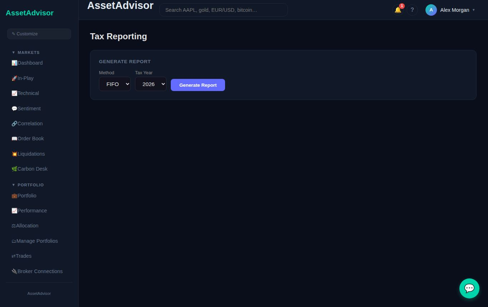

Tax Report works out the profit or loss on the sales in your trade history for one year. The page heading reads **Tax Reporting**.

1. Choose a portfolio, or all portfolios, in the switcher in the top bar. The report covers whatever is selected there.
2. Under **Generate Report**, choose the **Method**:
   - **FIFO** (first in, first out): each sale is matched with your oldest remaining purchases first.
   - **LIFO** (last in, first out): each sale is matched with your most recent purchases first.
3. Choose the **Tax Year**, from the current year back to 2015.
4. Select **Generate Report**.

#### Reading the report

| Tile | What it means |
|---|---|
| **Net Realized Gain/Loss** | Gains minus losses on the year's sales. |
| **Gains** and **Losses** | The two totals separately. |
| **Lots Sold** | The number of rows in the table. A sale matched against several purchases appears once per purchase. |
| **Method** and **Tax Year** | The settings used. |

A line under the tiles confirms which portfolio was used. Cost basis looks at your whole trade history, so a sale this year is correctly matched with a purchase made in an earlier year. Only sales made in the chosen year are listed.

The **Realized Gains** table shows, for each matched sale:

- **Sell Date** and **Buy Date**.
- **Instrument** and **Quantity**.
- **Proceeds**: what you received, minus the sale's fees.
- **Cost Basis**: what you paid, including the purchase fees.
- **Gain/Loss**: proceeds minus cost basis.

Select **Download CSV** to save the table as a spreadsheet file, with the method on each row.

If some sales have no earlier purchase on record, an orange warning says how many units are affected. Their cost basis is unknown, so they are left out of the totals. Add the missing purchases on the Trades page and generate the report again.

Tax figures are an aid for your own records, not tax advice.

## Alerts

Alerts tell you when an instrument reaches a level you care about. They appear under the bell and on the dashboard, and on WhatsApp if you linked it.

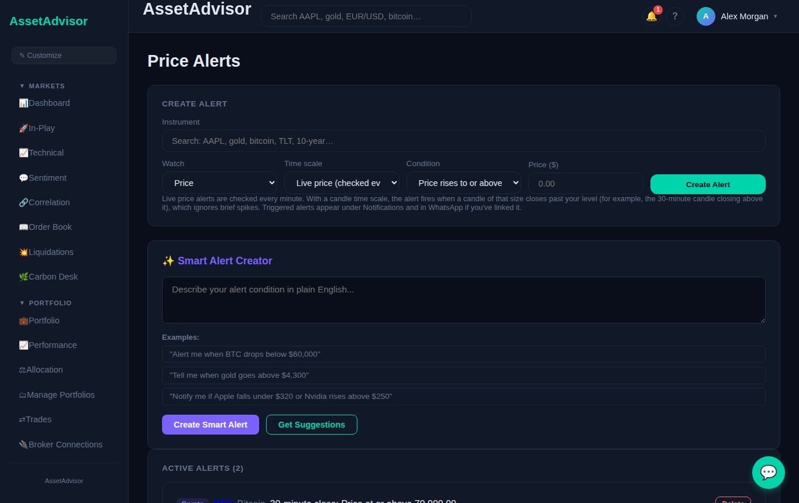

### Creating an alert

On **Alerts** (Tools group), fill in:

1. **Instrument**: search by ticker or name. The current price is shown under it.
2. **Watch**: **Price** (or **Yield** for Treasury yields), **RSI (14)** or **Stochastic RSI %K (14, 14, 3)**.
3. **Time scale**: **Live price (checked every minute)**, or a candle close from **5-minute** to **9-day**.
4. **Condition**: rises to (or closes at) or above, or falls to (or closes at) or below.
5. **Price**, **Yield (%)** or, for RSI and Stochastic RSI, a **Level** between 0 and 100.

Then select **Create Alert**.

### Live price or candle close

| Time scale | When the alert fires |
|---|---|
| Live price | As soon as the latest quote is at or past your level. Checked every minute. A quote cached during a data outage never fires an alert |
| A candle size, for example 30-minute | When a candle of that size **closes** at or past your level. A brief spike that reverses before the candle ends doesn't count |

Candle alerts only look at candles that close after you created the alert, so an alert never fires because of something that already happened. RSI and Stochastic RSI alerts always use a candle time scale, because those indicators are calculated from candles. A daily stock candle closes when the market closes; 3-day, weekly and 9-day candles on stocks count as closed once the next one has started.

Each alert fires once. Its message names the time scale, for example "Bitcoin 30-minute candle closed at 61,200.00 (above 61,000.00)" or "Bitcoin 1-hour candle RSI (14) closed at 72.4 (above 70)". Fired alerts move to **Triggered**, where you can see the value and time they fired and remove them.

### Smart alerts

In the **Smart Alert Creator** you can type an alert in plain English, for example "Tell me when BTC closes above 90,000 on the 30 minute" or "Alert me if Apple's hourly RSI goes below 30". Select **Create Smart Alert**; the assistant turns it into conditions for you to check, then select **Confirm & Save**. Price, RSI and Stochastic RSI conditions are saved as alerts with the time scale you mentioned (live price if you didn't name one; 1-hour candles for RSI and Stochastic RSI). Conditions on volume, gas or percentage change can't be saved as alerts yet, and the page says so.

## WhatsApp

Link your WhatsApp to get alerts there and to chat with the AssetAdvisor assistant from your phone. Open **WhatsApp** from the user menu (or from Settings).

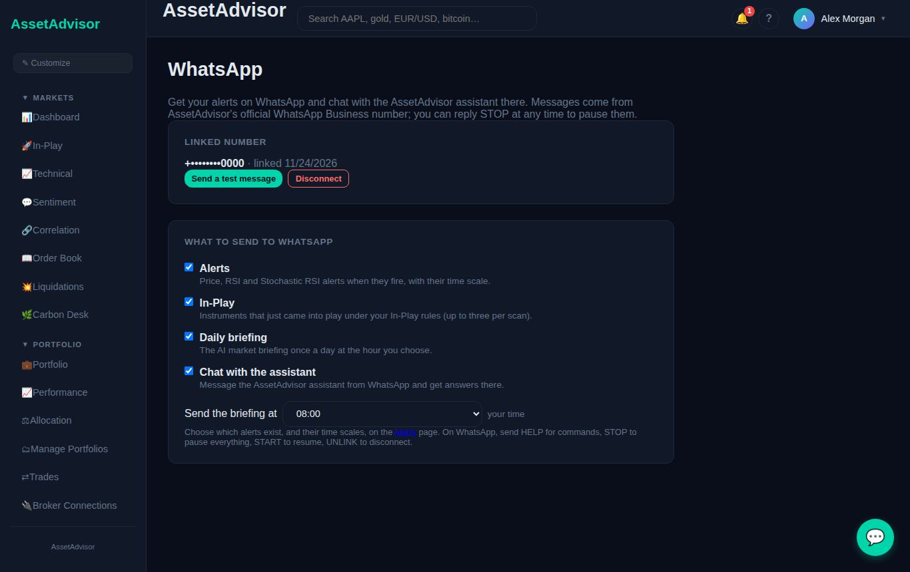

### Linking your number

1. Select **Link WhatsApp**. The page shows a six-digit code.
2. On your phone, use the link on the page to open WhatsApp with the message filled in, or send it yourself to the number shown: **LINK** followed by the code, for example `LINK 482913`.
3. The page updates by itself when your message arrives. The code works once, for 15 minutes.

Sending the code from your own WhatsApp proves the number is yours. A number can be linked to one account at a time; linking it to another account unlinks the first.

### What is sent

Choose any of these under **What to send to WhatsApp**:

| Option | What you get |
|---|---|
| Alerts | Every alert when it fires, with its time scale |
| In-Play | Instruments that just came into play under your In-Play rules, up to three per scan |
| Daily briefing | The AI market briefing once a day at the hour you choose, in your own time zone |
| Chat with the assistant | Message the assistant from WhatsApp and get answers there |

Use **Send a test message** to check that everything works.

### Chatting with the assistant

Send any question, for example "How is my portfolio doing?" or "What's the RSI on BTC?". It is the same conversation as the assistant in the app, so you can continue in either place. Replies on WhatsApp are kept short. If the assistant proposes doing something for you (for example setting an alert), it tells you to confirm it in the app; nothing is changed from WhatsApp alone. You can ask up to 30 questions an hour.

### Commands

| Send | What it does |
|---|---|
| HELP | Lists what you can do |
| STOP | Pauses everything AssetAdvisor sends you on WhatsApp |
| START | Resumes it |
| UNLINK | Disconnects the number from your account |

You can also select **Disconnect** on the WhatsApp page.

### The 24-hour rule

WhatsApp only lets businesses message you freely within 24 hours of your last message to them. After that, alerts can only be sent if your administrator has set up an approved WhatsApp message template. If the page says so, send any message (for example HELP) to AssetAdvisor now and then to keep alerts arriving. Alerts always appear in the app as well.

## The AI assistant and AI tools

AssetAdvisor includes a chat assistant and a set of AI reports that read your holdings, trades and current market data and explain what they see in plain language. AI output is informational only. It can be wrong or out of date, it is not financial or tax advice, and it never places real orders. Treat it as a starting point for your own judgment. (The Tax Optimizer page says the same: "AI suggestions are for informational purposes only. Consult a tax professional before making any tax-related decisions.")

The AI reports live in the **AI Assistant** section of the sidebar: **Market Briefing**, **Risk Report**, **Tax Optimizer**, **Portfolio Builder**, **Pattern Recognition**, **Trading Coach** and **AI Memory**.

AI answers can take a little while to arrive, and the app waits up to about three minutes for one. If the AI service is unavailable, you see a short error message (in the reports it starts with "Error:") instead of an answer. Just try again later.

### AI Assistant chat

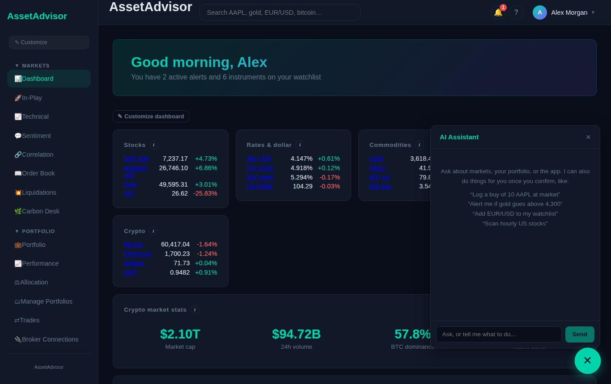

The assistant is a chat window you can open from any page. Use it to ask about markets, your portfolio, or how to do something in the app, or to ask it to make a change for you.

**Opening and closing it**

- Select the round chat button at the bottom right of any page to open the **AI Assistant** window.
- Select the **×** in the window header, or the chat button again, to close it.

**Asking a question**

1. Type in the box that says **Ask, or tell me what to do…**. Messages can be up to 4,000 characters.
2. Press **Enter** or select **Send**.
3. While the assistant works you see **Thinking...**, then its reply appears.

What the assistant knows when it answers:

- Your open positions from your trade journal (your 15 largest, with value, average price and unrealized profit or loss).
- Facts it has remembered about you (see AI Memory below).
- Your last 8 messages in the conversation, so follow-up questions like "and how do I remove it?" make sense.
- How AssetAdvisor works, so it can point you to the right page and button.

It does not see your price alerts or settings directly. Good things to ask:

- "What is my biggest position right now?"
- "How do I import trades from Coinbase?"
- "What would a stronger dollar mean for gold?"

**Asking it to do something**

The assistant can prepare changes for you, but nothing happens until you approve it. It can:

- log a trade in your trade journal (buy or sell, quantity, a price or "at market", and optionally a date, fee and which portfolio),
- create a price alert (above or below a price),
- add an instrument to, or remove one from, your watchlist,
- change your In-Play scanner settings (for example the timeframe or which markets to scan).

When the empty chat window opens it suggests a few examples, such as "Log a buy of 10 AAPL at market", "Alert me if gold goes above 4,300", "Add EUR/USD to my watchlist" and "Scan hourly US stocks".

Each proposed change appears as a card under the reply. The card shows what kind of change it is (**Log trade**, **Price alert**, **Watchlist** or **In-Play settings**) and a one-line summary, for example the instrument, quantity, price and date of a trade.

- Select **Confirm** to make the change. The card then shows **Done** with a short result, and any open page such as your portfolio, alerts or watchlist updates.
- Select **Cancel** to dismiss it. The card shows **Cancelled**.

Good to know:

- The assistant checks each proposal before showing it. If it cannot find the instrument, a number is missing or invalid, or (for a removal) the item is not on your watchlist, the card says **Can't do this** and explains why, with no buttons.
- A reply can include up to five proposals.
- For a trade "at market", the price shown is the current price when the card was created; if you confirm later, the trade is logged at the price at the moment you select **Confirm**.
- Proposals expire after one day. Confirming an older one marks it **Expired**; just ask again.
- If a confirmed change cannot be completed, the card shows **Failed** with the reason.
- Logging a trade only records it in your journal (it is marked "via chat"). AssetAdvisor never sends orders to a broker.

**Your conversation history**

Your conversation is saved on the server, so it is still there when you change pages, reload, or sign in on another device. The most recent 60 messages are kept. The same conversation is also available through WhatsApp (see the WhatsApp section); any change proposed there still has to be confirmed in the app.

**Starting over**

Select **Clear** in the window header to delete the conversation and start a new one. Clearing the chat does not delete the facts the assistant has remembered about you; manage those on the AI Memory page.

### Market Briefing

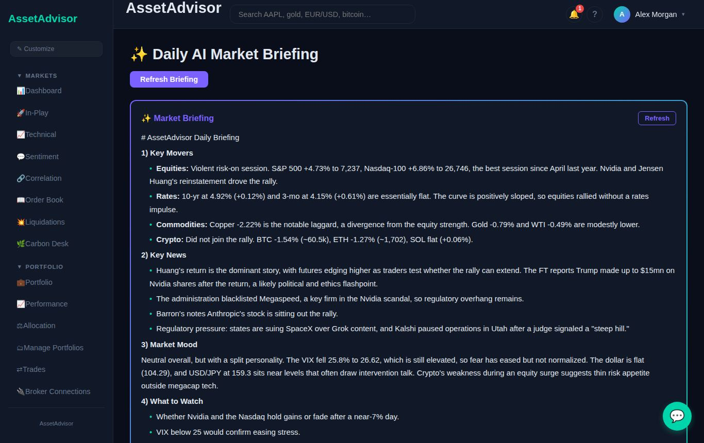

The Market Briefing gives you a short written overview of the markets today. The page is titled **Daily AI Market Briefing**.

**The daily briefing**

The briefing is generated automatically when you open the page. It is based on:

- current prices and daily moves across stocks, rates, commodities and crypto,
- recent general business and market headlines, plus crypto news headlines.

It covers the key movers and why, the most important news, the overall market mood (risk appetite and crypto sentiment) and what to watch next, in under about 300 words. The time it was created is shown under it as **Generated:**.

To get a fresh version, select **Refresh Briefing** at the top of the page or **Refresh** on the briefing panel.

**Coin Commentary**

Under **Coin Commentary** you can get a short commentary on a single cryptocurrency:

1. Choose a coin from the list (Bitcoin, Ethereum, Solana, Cardano, Polkadot, Avalanche, Chainlink or Dogecoin).
2. Select **Get Commentary**.

The commentary combines the coin's current price and 24-hour move with any related news headlines, and includes an outlook and key levels to watch, in under about 200 words. Select **Refresh** on the panel to generate it again.

This page does not use your holdings or trades.

### Risk Report

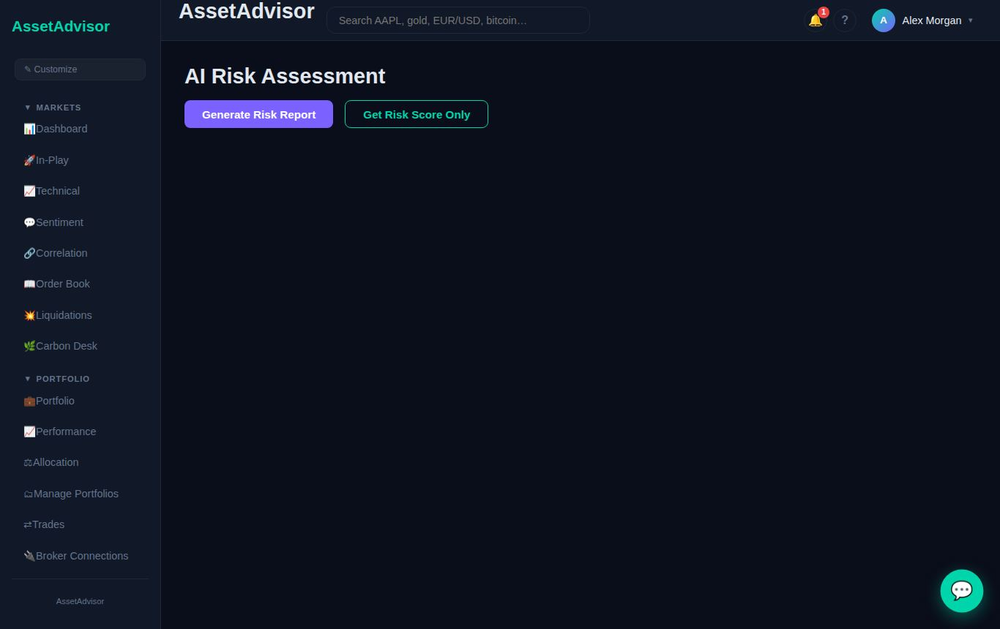

The Risk Report reviews your current holdings and describes the risks in your portfolio. The page is titled **AI Risk Assessment** and has two buttons.

**Generate Risk Report**

1. Select **Generate Risk Report**.
2. A short progress list shows while the report is being prepared.
3. The **Risk Assessment Report** panel appears when it is ready. Select **Refresh** on the panel to generate it again.

It uses your open positions (up to your 15 largest) with their current values and your total portfolio value. If you have added exchange connections, their names are included too.

The written report covers:

- concentration risk (too much in one asset),
- counterparty risk (exposure to exchanges),
- correlation risk (how closely your holdings move together),
- liquidity risk,
- regulatory risk,
- an overall risk score from 1 to 10 (10 is highest risk),
- specific recommendations to reduce risk.

When the app can find the overall score in the report text, it also shows it on a gauge out of 10 above the report, with a risk level badge.

**Get Risk Score Only**

Select **Get Risk Score Only** for a quick score without the full report. It uses your open positions (up to 10) and shows:

- a gauge with a score out of 100 (higher means more risk),
- a badge reading **Low Risk**, **Medium Risk**, **High Risk** or **Critical Risk**,
- a short list of your top risks.

If the AI does not return a usable score, you see "The AI did not return a usable risk score. Try again."

On both gauges the badge depends on how far along the scale the score is: under 30% is Low, under 60% Medium, under 80% High, and anything higher Critical.

If you have no open positions, there is little to analyze, so log or import your trades first.

### Tax Optimizer

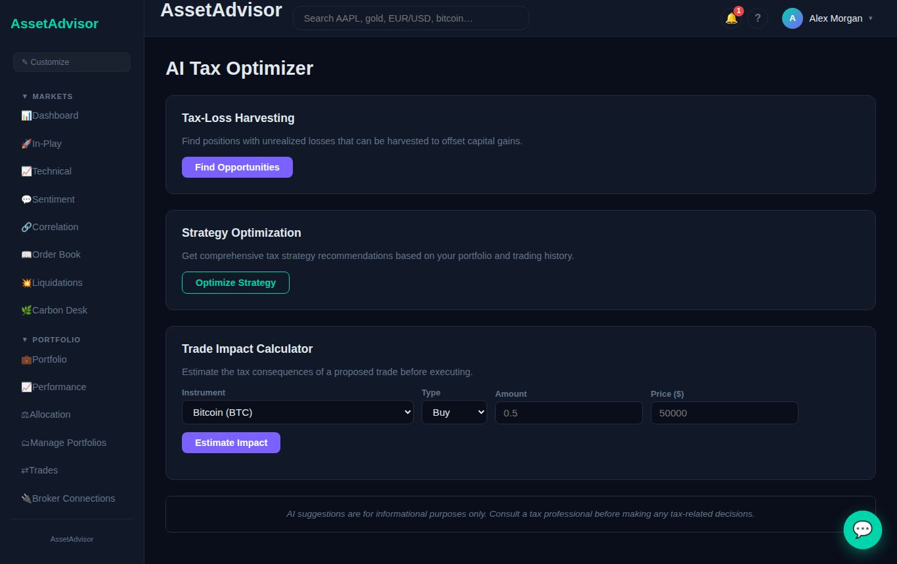

The Tax Optimizer looks for ways to reduce the tax on your investments. It assumes US tax rules and is aware of wash-sale rules for stocks and ETFs and the special 60/40 treatment for regulated futures. The page is titled **AI Tax Optimizer** and has three sections.

**Tax-Loss Harvesting**

Finds positions with unrealized losses that you could sell to offset capital gains.

1. Select **Find Opportunities**.
2. Results appear in the **Tax-Loss Harvesting Opportunities** panel.

It uses your open positions (current value and cost basis, up to 15) and your 10 most recent trades. The answer covers positions at a loss, wash-sale (30-day rule) considerations, timing suggestions and an estimate of possible tax savings.

**Strategy Optimization**

Gives broader tax strategy recommendations.

1. Select **Optimize Strategy**.
2. Results appear in the **Tax Strategy Recommendations** panel.

It uses your current holdings (up to 10). The answer covers short-term versus long-term holding periods, loss harvesting, charitable giving where it applies, timing for the rest of the year, and the estimated tax impact of your current approach.

**Trade Impact Calculator**

Estimates the tax effect of a trade before you make it.

1. Choose an **Instrument**. Instruments from your own trade journal are listed first, followed by a few common cryptocurrencies such as **Bitcoin (BTC)** and **Ethereum (ETH)**.
2. Choose the **Type** (**Buy** or **Sell**).
3. Enter the **Amount** and the **Price ($)**.
4. Select **Estimate Impact**.

The app works out your average buy price for that instrument from the buy trades in your journal, and the gain or loss the trade would produce at that price. The **Estimated Tax Impact** panel then shows the estimated tax (short-term versus long-term rates), net proceeds after tax, whether to trade now or wait for long-term treatment, and other ways to reduce the tax.

All AI answers on this page include a reminder that they are not tax advice. Always check with a tax professional.

### Portfolio Builder

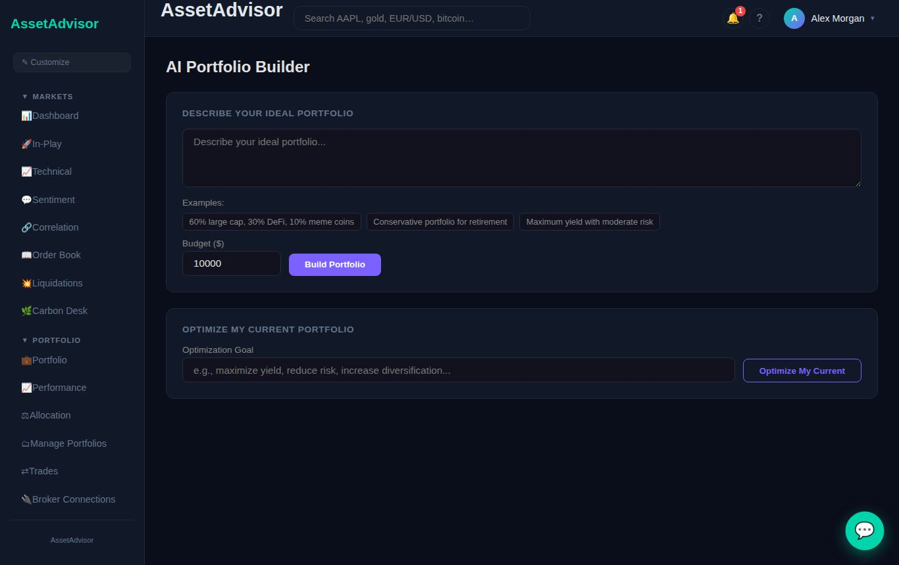

The Portfolio Builder suggests a portfolio from a plain-language description, or suggests changes to the portfolio you already have. The page is titled **AI Portfolio Builder**.

**Describe Your Ideal Portfolio**

1. Type what you want in the box (**Describe your ideal portfolio...**), or select one of the **Examples:** buttons, such as "Conservative portfolio for retirement", to fill it in.
2. Enter a **Budget ($)**. It starts at 10,000 and must be more than zero.
3. Select **Build Portfolio**.

The **AI Portfolio Recommendation** panel shows at least five positions, each with the instrument (ticker and asset class), its percentage, the dollar amount from your budget and a short reason, followed by a risk disclaimer. The AI uses only the asset classes your description allows; if you name none, it spreads across stocks, bonds, commodities and crypto to match the risk you describe. This part does not look at your current holdings.

**Optimize My Current Portfolio**

1. Optionally type an **Optimization Goal**, for example "reduce risk" or "increase diversification". If you leave it blank, the goal is to maximize risk-adjusted returns.
2. Select **Optimize My Current**.

It uses all your open positions (quantity and approximate value). The **Portfolio Optimization** panel suggests what to sell, what to buy and why, with percentage rebalancing and a risk disclaimer. If you have no open positions, you are asked to add trades in the Trade Journal first.

### Pattern Recognition

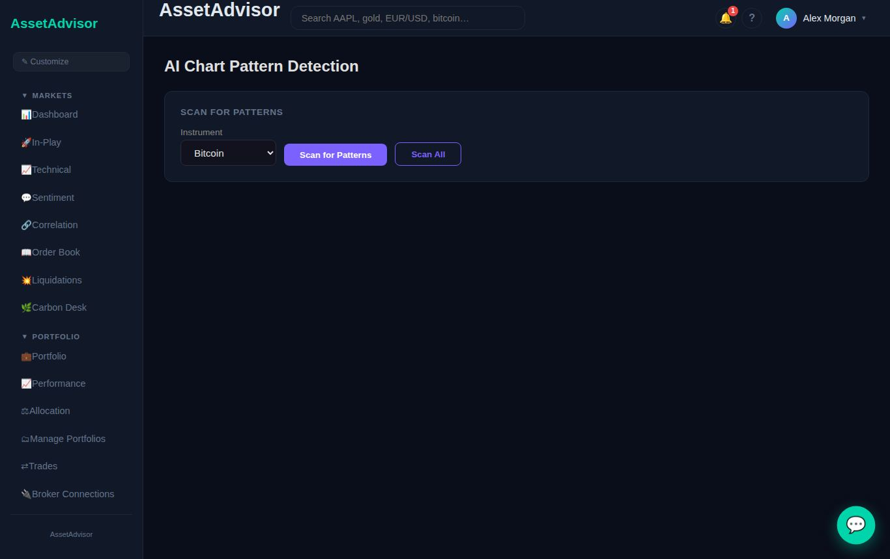

Pattern Recognition asks the AI to look for classic chart patterns, such as head and shoulders, double tops and bottoms, triangles, cup and handle, wedges and flags. The page is titled **AI Chart Pattern Detection**.

**Scanning one instrument**

1. Under **Scan for Patterns**, choose an **Instrument**: **Bitcoin**, **Ethereum**, **Solana**, **Apple (AAPL)** or **Gold futures**.
2. Select **Scan for Patterns**.

The AI reviews the last 30 days of daily prices (open, high, low and close). You get back:

- a **Pattern Summary** panel with two or three sentences on the overall picture (or "No clear chart patterns detected."),
- under **Detected Patterns**, a card for each pattern found, showing its name, confidence (low, medium or high), whether it is bullish, bearish or neutral (with an up, down or sideways arrow), a **Target** price when there is one, and a one-sentence description.

**Scanning all five**

Select **Scan All** to scan every instrument in the list one after another. Under **Pattern Scan: All Instruments**, each instrument shows the names of its patterns with a direction arrow, or "No patterns detected." This takes longer because each instrument is a separate AI request.

### Trading Coach

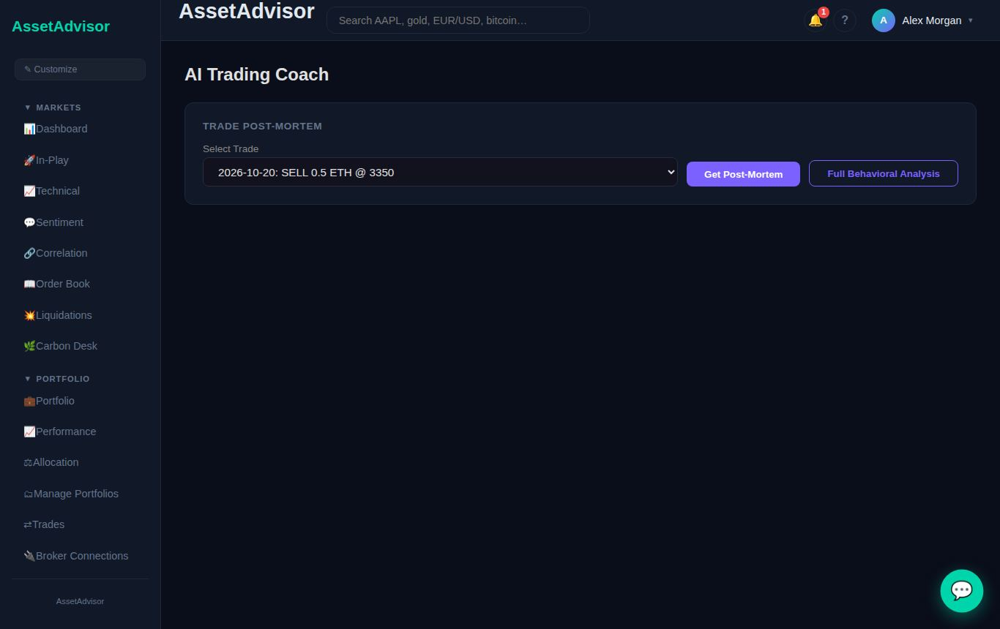

The Trading Coach reviews your own trades, either one at a time or all together. It works on the trades in the portfolio you are viewing. The page is titled **AI Trading Coach**.

**Reviewing one trade**

1. Under **Trade Post-Mortem**, choose a trade from **Select Trade**. Each entry shows the date, side, quantity, symbol and price.
2. Select **Get Post-Mortem**.

The AI is given the trade's details (side, quantity, price, fee, date and notes), the current price and how much it has moved since the trade, the daily move, and, if the trade closed a position, its realized profit or loss. The **Trade Post-Mortem** panel covers what went right, what went wrong, whether the timing was good, what to do differently and the key lesson. Select **×** to close it.

**Reviewing all your trades**

Select **Full Behavioral Analysis**. The app first calculates statistics from your trade journal and shows them as tiles:

- **Total Trades** and **Closed Trades**
- **Win Rate**
- **Avg Hold Time** (in days)
- **Realized P&L**, **Avg Win** and **Avg Loss**
- **Trades per Week**

A closed trade is one that sells (or covers) all or part of a position; its profit or loss is measured against your average cost, after that trade's fee. Win rate and hold time need at least one closed position, and the page tells you so if you have none yet.

Below the tiles, the **Full Behavioral Analysis** panel gives AI coaching based on these statistics and your last 50 trades. It looks for revenge trading, buying after big price spikes, panic selling during sharp dips and overtrading, with examples from your trades and practical advice. If the AI is unavailable, the statistics still show, with an error message in place of the coaching.

If the portfolio has no trades yet, you see "No trades in this portfolio yet. Log trades in the Trade Journal to get an analysis."

### AI Memory

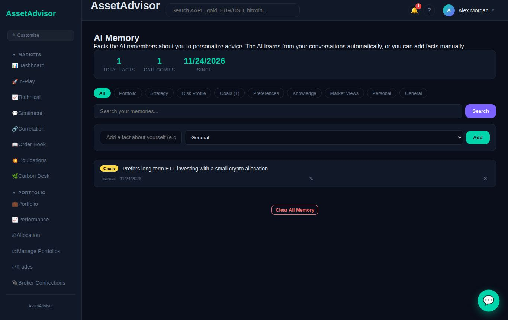

AI Memory shows the facts the assistant remembers about you so it can tailor its answers, for example your goals, risk tolerance or strategy. You can open it from the sidebar or from **AI Memory** in the user menu at the top right.

**Where facts come from**

- **From your chats.** After each chat message, the app looks for personal facts in what you said and saves new ones automatically. These are labeled **chat**.
- **Added by you.** Facts you type in yourself are labeled **manual**.

When you chat, the facts most relevant to your message are given to the assistant along with your question.

**What you see**

- A summary bar with **Total Facts**, the number of **Categories** used, and **Since** (the date of your oldest fact).
- Each fact shows its category, the text, where it came from, the date it was added and, if the assistant has used it, how many times (for example **Used 3x**).

**Filtering and searching**

- Select a category pill to show only that category: **Portfolio**, **Strategy**, **Risk Profile**, **Goals**, **Preferences**, **Knowledge**, **Market Views**, **Personal** or **General**. Select **All** to show everything.
- Type in **Search your memories...** and press **Enter** or select **Search**. Select **Clear** to go back to the full list.

**Adding a fact**

1. Type it in the box that starts **Add a fact about yourself**, for example "I plan to hold my index funds for 10 years".
2. Choose a category from the list next to it (**General** by default).
3. Press **Enter** or select **Add**.

Facts need at least five characters. If yours is shorter, you see "A fact needs at least 5 characters."

**Editing a fact**

Select the pencil icon on a fact, change the text or category, then select **Save** (or **Cancel**).

**Deleting facts**

- To delete one fact, select its **×** (Delete) button and confirm "Delete this fact?".
- To delete everything, select **Clear All Memory** at the bottom of the page (shown when you have facts) and confirm. This cannot be undone.

If a save, edit or delete fails, a short message under the add form explains why.

### AI Analysis buttons on other pages

Several pages have buttons that ask the AI about what is on that page:

- **Portfolio**: **AI Analysis** reviews your holdings for balance, concentration, diversification gaps and suggested target percentages.
- **Trade Journal**: **Analyze My Trades** looks for patterns and areas to improve across your trade history. **Get Trade Suggestions** suggests possible trades based on your holdings and current prices.
- **Technical Analysis**: **AI Analysis** comments on the instrument selected at the top of the page, using its current price, daily move and its SurgeX reading.

Selecting one of these buttons opens a pop-up titled **AI Analysis** that shows **Analyzing...** and then the answer. If something goes wrong, select **Retry**. Close the pop-up with **×** or by selecting outside it.

The answer is also placed in an insights panel on the page (**Portfolio AI Insights**, **Trade AI Insights** or **Technical AI Insights**). Select **Refresh** on the panel to run the analysis again (on the Trade Journal, Refresh reruns **Analyze My Trades**), or **×** to close it. Until you run an analysis, the panel says "Click AI Analysis to get insights".

### Smart Alert Creator

The **Smart Alert Creator** is on the Alerts page. It lets you describe an alert in everyday words instead of filling in a form.

1. Type your condition in the box (**Describe your alert condition in plain English...**), or select one of the **Examples:**, such as "Tell me when gold goes above $4,300".
2. Select **Create Smart Alert**. The AI turns your words into one or more conditions, shown under **Parsed Conditions:** with the instrument, what is measured, above or below, the level, and whether it uses the live price or a candle close (for example "1h candle close").
3. Check them, then select **Confirm & Save** to create the alerts. A message tells you how many were saved.

What can be saved:

- Price, RSI and Stochastic RSI conditions that are above or below a level. Say a timeframe such as "on the 30 minute" or "daily close" to judge it on a candle close; price alerts without a timeframe use the live price, and RSI alerts default to hourly candles.
- Other kinds of conditions (such as volume or percentage change) are shown but cannot be saved as alerts yet; the message tells you how many were skipped.
- If an instrument cannot be found, you are asked to try its ticker instead (for example AAPL, BTC or GC).

**Get Suggestions** asks the AI for about five alert ideas based on your holdings, each with a short reason. Select the suggestion text to copy it into the box, then edit it down to the alert you want before selecting **Create Smart Alert**.

## Settings, security and your data

Everything about your own account lives in the user menu: select your name in the top bar. This section covers each of those pages in turn, then account deletion. WhatsApp, CSV Import and AI Memory are covered in their own sections. Telegram notifications are no longer offered; to get alerts on your phone, use **WhatsApp** in the user menu.

### Settings

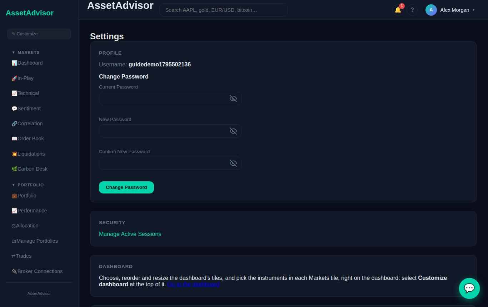

Settings collects your profile, sign-in options and account deletion on one page. It is made of cards, from top to bottom.

**Profile.** Shows your **Username**, which cannot be changed. Below it is a **Change Password** form that works exactly like the **Change Password** page (see below).

**Connected sign-ins.** This card appears only when the site offers Google or Microsoft sign-in, or when you already have a connected sign-in. It lets you sign in with those accounts instead of your password.

- Select **Connect Google** or **Connect Microsoft**. You are sent to that provider to approve, then brought back here with a message such as "Google is now connected."
- Each connected sign-in is listed with its email address and a **Disconnect** button. A company sign-in that you linked from your firm shows as **Company sign-in (SAML)**.
- A Google or Microsoft account can be connected to only one AssetAdvisor account.
- If your account was created through company sign-in and has no password, you cannot disconnect your only way of signing in. Set a password first on the **Change Password** page.

**Security.** Select **Manage Active Sessions** to see and sign out the devices signed in to your account (see **Active Sessions** below).

**Dashboard.** Points you to the dashboard, where you choose and arrange tiles yourself with **Customize dashboard**. See the dashboard section.

**WhatsApp.** A link to the WhatsApp setup page. See the WhatsApp section.

**Delete account.** See **Deleting your account** below.

### Change Password

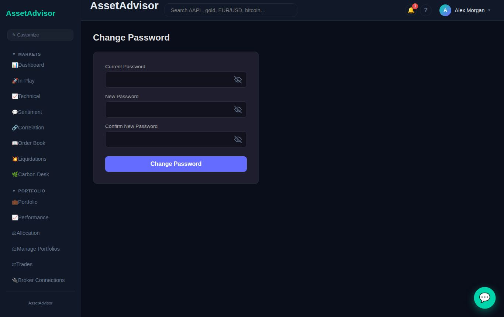

Use this page to pick a new password.

1. Enter your **Current Password**.
2. Enter a **New Password** of at least 10 characters.
3. Enter it again in **Confirm New Password**.
4. Select **Change Password**.

The eye icon in each field shows or hides what you typed. When it works you see "Password changed successfully", followed by how many other sessions were signed out.

**Changing your password signs out every other device** signed in to your account. The device you are using stays signed in. This makes changing your password the quickest fix if you think someone else knows it.

If your account was created through company sign-in, it has no password of its own. You can set one here: the current password is not checked in that case. After that you can also sign in with your username and password (unless your firm requires company sign-in).

Error messages you might see: "New passwords do not match", "New password must be at least 10 characters", "Current password is incorrect".

### Active Sessions

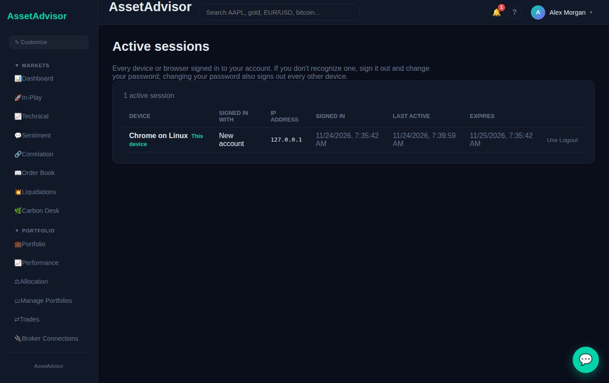

This page lists every device or browser that is signed in to your account right now. If you don't recognize one, sign it out and change your password.

The count at the top shows how many sessions are active. Each row shows:

| Column | Meaning |
|---|---|
| **Device** | The browser and system, for example "Chrome on Windows". The one you are using is marked **This device**. |
| **Signed in with** | **Password**, **New account** (signed in when the account was created), **Google**, **Microsoft** or **Company sign-in** |
| **IP address** | The network address the session signed in from |
| **Signed in** | When the session started |
| **Last active** | When it was last used |
| **Expires** | When it ends by itself |

To end a session, select **Sign out** on its row. It stops working immediately. Your own session shows **Use Logout** instead; sign out of it with **Logout** in the user menu.

To end everything except the device you are using, select **Sign out all other devices** and confirm. The button appears only when other sessions exist.

### API Keys

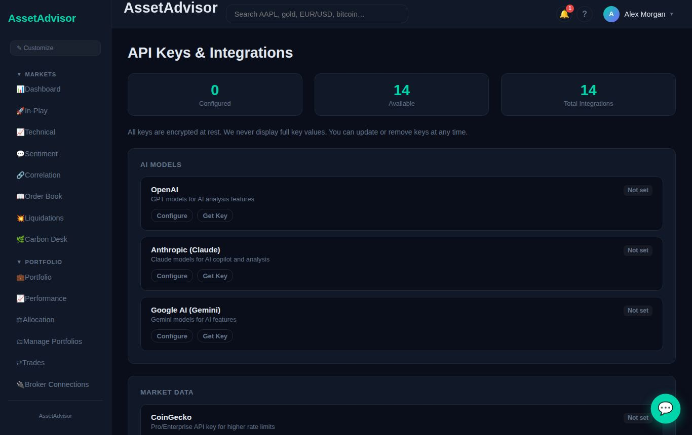

This page stores your personal keys for outside services, such as AI providers and market data or blockchain services.

At the top, three numbers show how many integrations are **Configured**, how many are **Available** and the **Total Integrations**. The integrations are grouped into cards:

| Group | Services |
|---|---|
| **AI Models** | OpenAI, Anthropic (Claude), Google AI (Gemini) |
| **Market Data** | CoinGecko, CoinMarketCap, CryptoCompare |
| **Blockchain & RPC** | Etherscan, BscScan, PolygonScan, Arbiscan, Infura, Alchemy, Moralis |
| **Payments** | Stripe |

Each service shows **Connected** when you have saved a key, or **Not set** when you haven't.

- Select **Configure** (or **Update** for a saved key), fill in the fields and select **Save**. **Cancel** closes the form without saving.
- When updating, any field you leave blank keeps its current value, so you can change just one field of a two-field service such as Infura or Stripe.
- **Remove** deletes the saved key for that service.
- **Get Key** opens the provider's own website, where you can create a key.

Keys are encrypted when stored, and the page never shows them in full: you only see the last four characters. If a save or removal fails, the reason is shown in red at the top of the page.

Please note: at the moment no AssetAdvisor feature reads the keys saved on this page. Prices, AI features and other data all run on the site's own connections, so you do not need to enter any keys to use the app.

### Data Export

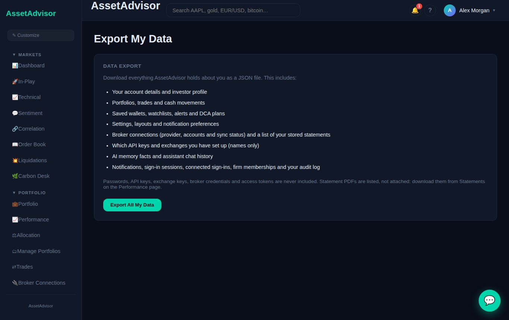

Use this page to download everything AssetAdvisor holds about you as a single JSON file (a plain text format that other programs can read).

Select **Export All My Data**. While it works the button reads "Compiling data...". The file downloads with a name like `assetadvisor-export-2026-11-24.json`.

The file contains:

- your account details and investor profile (your setup wizard answers)
- your portfolios, trades and cash movements
- saved wallets, watchlists, alerts and DCA plans
- settings, layouts and notification preferences
- broker connections (the provider, accounts and sync status) and a list of your stored statements
- which API keys and exchanges you have set up (names only)
- what the AI assistant remembers about you and your chat history with it
- your notifications, sign-in sessions, connected sign-ins, firm memberships and your audit log

Passwords, API keys, exchange keys, broker credentials and access tokens are never included. Statement PDFs are listed, not attached: download them from Statements on the Performance page.

If the export fails, the reason is shown above the button; try again.

### Audit Log

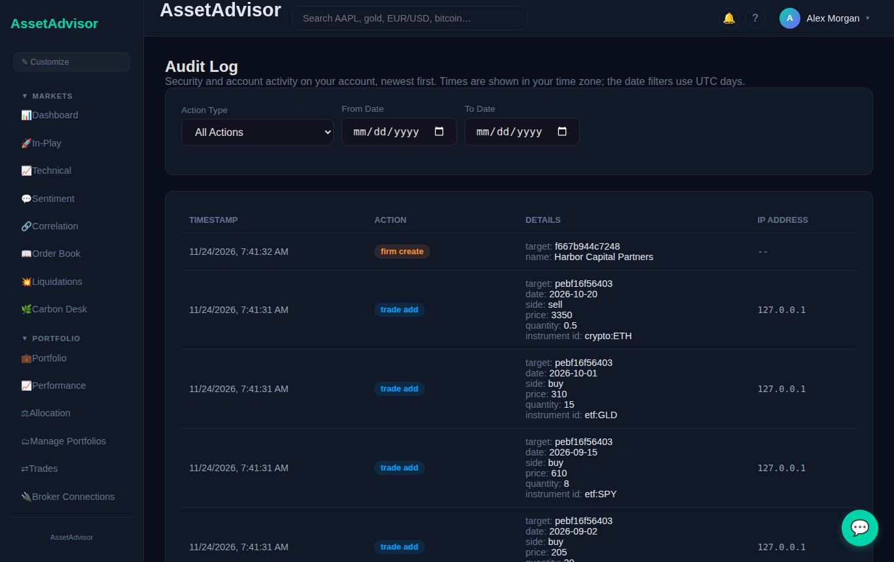

The Audit Log shows the security and account activity on your own account, newest first. Only things you did yourself are listed.

Each row shows:

| Column | Meaning |
|---|---|
| **Timestamp** | When it happened, in your local time |
| **Action** | What happened, in plain words, such as "Signed in", "Failed sign-in", "Password changed", "Session signed out", "Account created" or "Sign-in connected" |
| **Details** | Extra facts about the event, such as the sign-in method, shown as short "name: value" lines. Lists are summarized as a number of items. |
| **IP Address** | The network address it came from |

To narrow the list:

- **Action Type** picks a category: **All Actions**, **Sign-ins (including failed)**, **Sign-outs**, **Password Changes**, **Signed-out Sessions**, **Account**, **Connected Sign-ins**, **Portfolios**, **Trades and Orders**, **Cash Movements**, **Broker Connections**, **Allocation Targets**, **Firm Administration** or **WhatsApp**.
- **From Date** and **To Date** limit the list to those days, including both ends. These dates are UTC days, as the page notes; the Timestamp column shows your own time zone. The From date must be on or before the To date.

The list updates as soon as you change a filter. It shows 25 entries at a time; select **Load More** at the bottom to see older ones. When nothing matches, you see "No audit log entries found."

If you are a firm admin or compliance member, the firm's **Audit trail** shows everyone's activity in that firm (see **Firm accounts**).

### Help & Docs

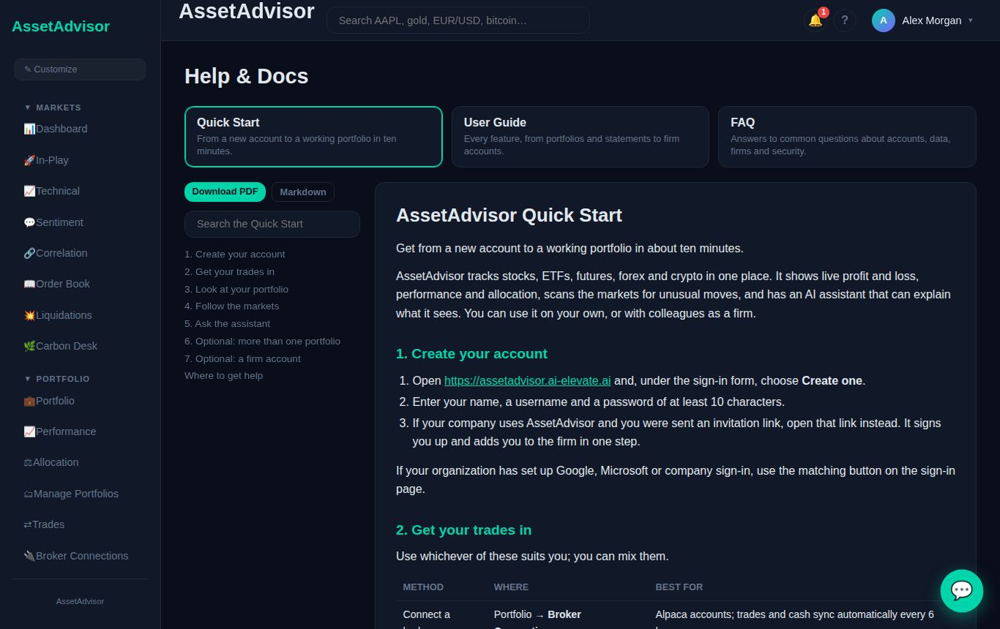

Help & Docs holds the written guides. You can open it from the user menu or from the **Tools** group in the sidebar.

Tabs across the top choose the document: **Quick Start** (from a new account to a working portfolio in ten minutes), **User Guide** (every feature) and **FAQ** (common questions). Site administrators also see an **Operations Runbook** tab marked **Admins**.

Inside a document:

- **Download PDF** saves a printable copy. **Markdown** saves it as a plain text file.
- The search box ("Search the" followed by the document name) narrows the document to the sections that mention what you type. If nothing matches, it says so.
- The list of section titles on the left jumps to that section.
- At the end of the Quick Start and User Guide, a link takes you to the **FAQ**. You can also ask the AI assistant with the chat button in the bottom-right corner.

### Deleting your account

You can permanently delete your account from the **Delete account** card at the bottom of **Settings**. This cannot be undone, so consider using **Data Export** first.

1. Select **Delete my account…**.
2. Enter **Your password**. If you only ever sign in through your company and have no password, type your username instead.
3. In **Type DELETE to confirm**, type `DELETE` in capital letters.
4. Select **Permanently delete account**. (**Cancel** closes the form.)

You are signed out and returned to the sign-in page.

What is removed: your portfolios, trades, cash, statements, alerts, watchlist, settings, broker connections, portfolio sharing, sign-in connections, phone and messaging alert setups, all your signed-in sessions, your firm memberships and everything the AI assistant remembers about you.

What is kept: entries in audit trails stay, so firms keep their records, but your username in them is replaced so they no longer identify you.

Deletion is refused in two cases:

- You are the only admin of a firm. Make someone else admin, or delete the firm, first.
- Yours is the site's only administrator account.

## Firm accounts

Firms are for teams that manage portfolios together, such as an advisory practice or a family office. A firm owns its own portfolios, which its members work on together according to their roles. It also brings invitations, company sign-in and an audit trail. Firms are optional: on your own, you never need one, and your personal portfolios always stay yours and separate.

### Firm Accounts

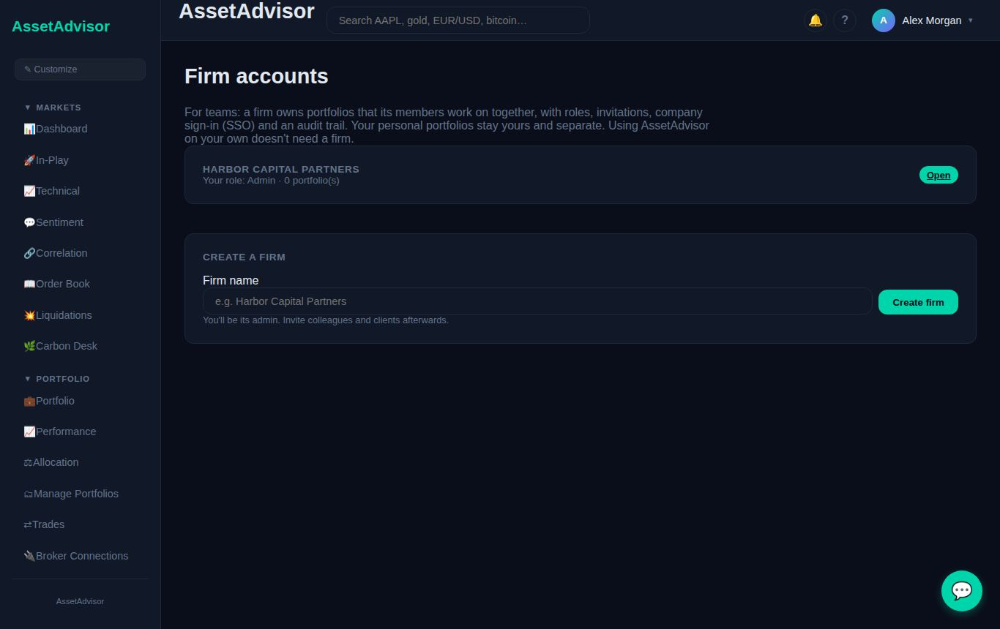

Open **Firm Accounts** in the **Portfolio** group of the sidebar. The page lists every firm you belong to, with **Your role** and how many portfolios it has. Select **Open** to go to a firm's page.

If the page says "Firm accounts aren't available on this server", firms are turned off on this site.

**Creating a firm**

1. Under **Create a firm**, enter a **Firm name** (2 to 80 characters).
2. Select **Create firm**.

You become the firm's admin and go straight to its page. From there you can invite colleagues and clients.

### The firm page

The firm's name is at the top, followed by your role (for example "you are Admin"). Tabs below it open each part of the firm. Which tabs you see depends on your role:

| Tab | Who sees it |
|---|---|
| **Portfolios** | Everyone |
| **Members** | Everyone |
| **Invitations** | Admins |
| **Sign-in & SSO** | Admins |
| **Audit trail** | Admins and compliance |
| **Delete** | Admins |

#### Roles

| Role | What it can do |
|---|---|
| **Admin** | Everything: members, invitations, sign-in policy, company sign-in, firm portfolios, the audit trail and deleting the firm |
| **Portfolio manager** | Create firm portfolios, move personal portfolios in, and log trades, cash and targets |
| **Analyst** | View all firm portfolios |
| **Compliance** | View all firm portfolios and the audit trail, which includes access reviews |
| **Viewer** | View all firm portfolios |

A firm always keeps at least one active admin.

#### Firm portfolios

The **Portfolios** tab lists the firm's portfolios with their **Portfolio** name, **Type** and **Client**. Select **Open** to view one on the Portfolio page; the top-bar switcher changes to it. When the firm has more than one portfolio, **View all** followed by the firm's name and "portfolios combined" shows them together.

Admins and portfolio managers also see **Add a portfolio**:

- Enter a **Name**, choose a **Type** (**Client account**, **Model portfolio** or **House account**) and, if you like, a **Client name**. Select **Create**. (In the list, a house account shows the type "personal".)
- **Or move one of your personal portfolios in**: choose it and select **Move into firm**, then confirm. The portfolio moves with its trades, cash and statements, and stops being a personal portfolio. Your default portfolio cannot be moved.

Firm portfolios appear in every member's portfolio switcher under the firm's name and work with every portfolio feature.

#### Members

The **Members** tab lists everyone in the firm with their **Role**, **Status** (active or suspended), **Last sign-in** and when they were **Added** (and by whom). Everyone can see the list. Admins can also:

- change a member's role with the drop-down in the **Role** column
- select **Suspend** to remove someone's access at once. Select **Reactivate** to give it back. A suspended member no longer sees the firm and cannot use the firm's company sign-in.
- select **Remove** to take someone out of the firm, after confirming
- select **Confirm access review** after checking that every member still needs their access. The date of the **Last full review** is shown next to the button, and each review is recorded in the audit trail. Auditors often ask for this.

Admins cannot suspend or remove themselves from this list.

#### Invitations

Admins invite people from the **Invitations** tab.

1. Choose a **Role**.
2. Optionally enter who it is **For (optional, for your records)**, such as their email address. AssetAdvisor does not send email; this is only a note for you.
3. Select **Create invitation link**.
4. Select **Copy** and send the link to the person yourself.

The link works once and expires in 7 days. It is shown only once, so copy it before leaving the page.

Past invitations are listed with their **Role**, who they were **For**, when they were **Created** and by whom, and their **Status**: pending, accepted (with who accepted), revoked or expired. Select **Revoke** to cancel a pending invitation.

#### Sign-in policy

On the **Sign-in & SSO** tab, the **Sign-in policy** card sets how members sign in:

- **Company email domains (people signing in with these are added automatically).** For example `example.com`. People who sign in with Google using a verified email on these domains, or through your company sign-in, join the firm automatically. If you use company sign-in, only email addresses on these domains are accepted there. Listing your domains also lets members type their work email under **Sign in with your company** on the sign-in page.
- **New members from company sign-in start as.** The role people get when they join this way: Portfolio manager, Analyst, Compliance or Viewer (never Admin).
- **Sessions end after (hours, 1–24).** How long members stay signed in. If someone belongs to several firms, the shortest setting applies.
- **Require company sign-in for members.** Members must sign in with Google, Microsoft or your company sign-in; their password stops working. Admins can still use their password, so you can't lock yourselves out.

Select **Save policy**. You see "Sign-in policy saved."

#### Company sign-in (SAML)

The **Company sign-in (SAML 2.0)** card connects your firm to your own identity provider, such as Okta, Microsoft Entra ID, Google Workspace or Ping.

1. In your identity provider, create a SAML app using the values shown on the card: the **Entity ID / metadata URL** and the **ACS (reply) URL**. The **Name ID** should be the email address.
2. Back in AssetAdvisor, fill in the **Identity provider entity ID (issuer)**, the **Identity provider sign-in URL** (it must start with https://) and the **Signing certificate (PEM)**.
3. Optionally enter an **Email attribute name** if your provider sends the email in a separate attribute; otherwise the Name ID is used.
4. Keep **Enabled** ticked and select **Save SAML settings**. You see "SAML settings saved."

Once a certificate is saved, the certificate box says it is saved. To change any of the other fields later, paste the certificate again.

To check the setup with your own account, select **Test: link my company sign-in**. You go through your company's sign-in and come back to the firm page, with your company sign-in connected to your account.

Members then sign in from the sign-in page with **Sign in with your company**. Someone signing in this way for the first time gets an account automatically and joins the firm with the starting role you chose. People who are already members simply sign in.

#### Audit trail

Admins and compliance members see the **Audit trail** tab. It records every sign-in-policy, membership, portfolio, trade and cash change in the firm, along with company sign-ins, invitations, audit exports and access reviews. Entries cannot be edited or deleted, and each one is chained to the one before it so any tampering would be detected. The system checks this every day.

Each row shows the **Time**, the **Person**, the **Action** (a short code such as `trade.add`), what it was **On**, where it came **From** (the network address) and the **Details**.

- To narrow the list, fill in any of **Action** (for example `trade.add`), **Person** (a username) and **Since** (a date), then select **Filter**.
- **Export CSV** downloads the trail as a spreadsheet file, from the **Since** date if you set one, up to 5,000 entries. Each export is itself recorded in the trail.
- The list shows 200 entries at a time. When there are more, select **Older** to load the next 200.

#### Deleting a firm

On the **Delete** tab, an admin can delete the firm with all its portfolios, trades, cash records and statements. Members keep their personal accounts. This cannot be undone.

Type the firm's name exactly as shown, then select **Delete** followed by the firm's name.
